# Archy GUI — Flow Manager · v1.61.0

> 🇩🇰 [Dansk](#dansk) · 🇬🇧 [English](#english)

---

## Changelog

Alle ændringer står i **[CHANGELOG.md](CHANGELOG.md)** — nuværende version er **v1.61.0**.
All changes live in **[CHANGELOG.md](CHANGELOG.md)** — the current version is **v1.61.0**.

---

<a name="dansk"></a>
## 🇩🇰 Dansk

Et grafisk interface til [Archy](https://help.mypurecloud.com/articles/archy/) med multi-kunde support, flow-migration, Data Action migration og OAuth PKCE login.

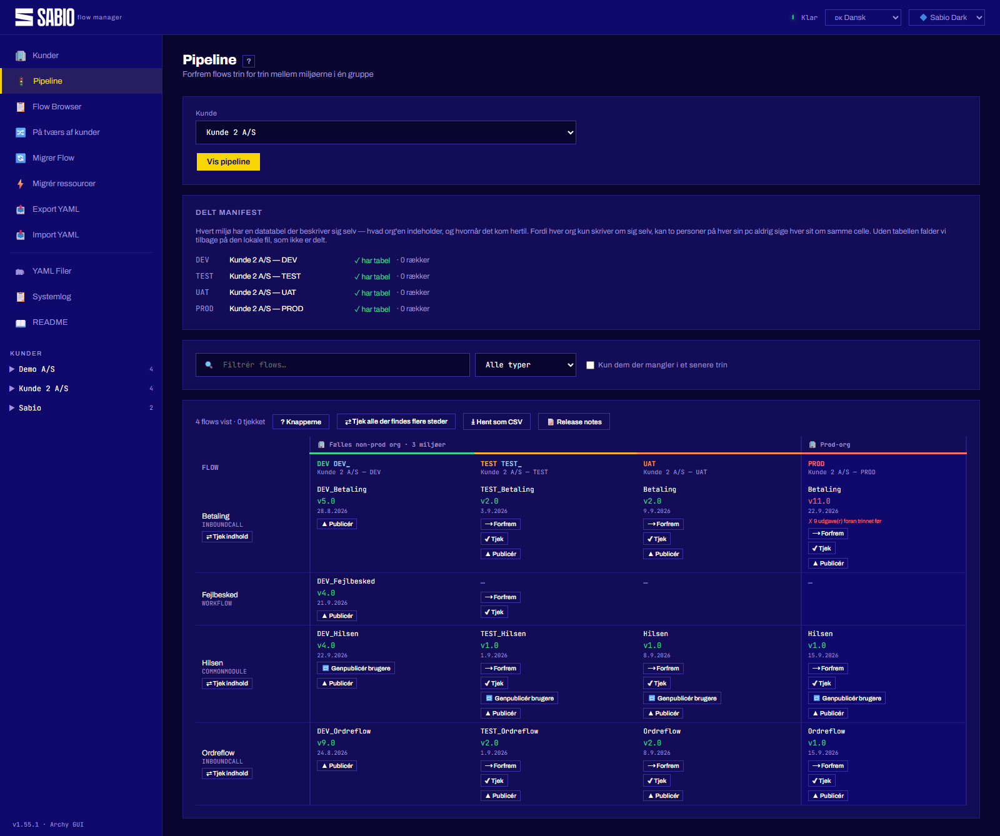

*Pipeline med Demo 2 — det man ser når programmet åbnes. Miljøerne står som kolonner i trin-rækkefølge, flowene som rækker.*

### Krav
- **Node.js 22.23.4, 24.22.1, 26.12.1 eller nyere** — versionerne med sikkerhedsrettelserne fra 21. oktober 2026 ([Node.js](https://nodejs.org/en/blog/vulnerability/october-2026-security-releases)). Ældre linjer (18, 20, 25) får ingen rettelser, og programmet skriver en advarsel ved start, hvis versionen er for gammel
- **Archy** installeret. Helst i PATH (`archy version` skal returnere en version); ellers leder programmet i `C:\Tools\Archy`, `C:\Archy`, `C:\Program Files\Archy` og din brugermappe, eller du skriver mappen med `archy.bat` i `archyDir` i `settings.json` (eller sætter miljøvariablen `ARCHY_DIR`). Genstart med `start.bat` bagefter
- **Windows** (`start.bat`/`stop.bat`) og en browser
- En Genesys Cloud OAuth-klient af typen **Code Authorization** (PKCE) pr. org, med redirect URI `http://localhost:3737/auth/callback` — se [opsætning nedenfor](#opsætning-af-oauth-klienten-pkce). Ældre miljøer med Client Credentials virker stadig, men nye oprettes altid med PKCE

#### Opsætning af OAuth-klienten (PKCE)

Gøres én gang pr. Genesys-org (se også **📋 Opsætning** i programmet, som fører dig gennem det samme og tjekker det mod org'en):

1. I Genesys Cloud: **Admin → Integrations → OAuth → Add Client**.
2. **Grant Type:** *Code Authorization*. (*Client Credentials* bruges kun af ældre miljøer.)
3. **Authorized redirect URIs:** `http://localhost:3737/auth/callback` — præcis sådan, uden skråstreg til sidst. Kører programmet på en anden port (`PORT`), skal URI'en følge den, og `OAUTH_REDIRECT_URI` i `server.js` ændres tilsvarende.
4. **Scope:** et kald skal være tilladt af **både** brugerens roller og klientens scopes. Vælg mindst `architect`, `scripts`, `integrations`, `authorization`, `routing`, `users`, `groups` og `oauth` (de fire sidste må gerne være `:readonly`). Mangler et scope, fejler kaldet med *app.not.authorized.for.scope* — **🔌 Test** viser det som `scope …` ud for funktionen. Et nyt scope gælder først efter et nyt login.
5. Gem, og kopiér **Client ID** (en GUID). Der er ingen secret at gemme; PKCE bruger ingen.
6. I programmet: opret miljøet med **🌐 OAuth (PKCE)**, indsæt Client ID, vælg region, og tryk **Log ind**. Log ind i den rigtige org — logger du ind i en anden, afvises tokenet.

**Rettigheder for den bruger der logger ind** (tjek dem med **🔌 Test**):

| Funktion | Rettigheder |
|---|---|
| Læse flows | `architect:flow:view`, `architect:ui:view` |
| Importere flows | `architect:flow:add`, `architect:flow:edit` |
| Publicere flows (og deploy til prod) | `architect:flow:publish` |
| Datatabeller og manifest | `architect:datatable:view/add`, `architect:datatableRow:view/add/edit` |
| Data Actions | `integrations:integration:view`, `integrations:action:view/add` |
| Prompts | `architect:userPrompt:view/add` |
| Scripts | `scripter:script:view/add`, `scripter:publishedScript:view/add` — og scopet `scripts` på OAuth-klienten |
| Divisioner, køer, brugere | `authorization:division:view`, `routing:queue:view`, `directory:user:view` |
| Afhængigheder | `architect:dependencyTracking:view` |
| Vise OAuth-klientens navn | `oauth:client:view` |

Mangler en rettighed, viser **🔌 Test** præcis hvilken. Er miljøet prod, kræves desuden deploy-retten (standard `architect:flow:publish`).

**Typiske fejl:** *redirect_uri mismatch* → URI'en i klienten er ikke præcis den ovenfor. *Forkert org* → du loggede ind i en anden org end miljøets. *Port optaget* → luk den anden instans med `stop.bat`.


### Installation

```bash
cd C:\Tools\Archy-gui
npm install
```

### Start

Dobbeltklik på **`start.bat`** — den:
1. Stopper eventuel tidligere instans på port 3737
2. Starter serveren **skjult i baggrunden** — output i `server.log`, fejl i `server.err.log`
3. Venter til serveren er klar (højst 30 sekunder — ellers vises de sidste linjer af `server.err.log`)
4. Åbner automatisk **http://localhost:3737** i browseren og lukker sit eget vindue

Serveren kører videre, når vinduet er lukket. **`stop.bat`** stopper den. Kører man `start.bat` igen, genstartes serveren — fx efter en opdatering.

Alternativt manuelt: `node server.js`

Er der sat grupper op, **åbner programmet på Pipeline** med den kunde du sidst arbejdede med — som på billedet øverst. Tavlen hentes når du trykker *Vis pipeline*.

---

### Sådan hænger det sammen

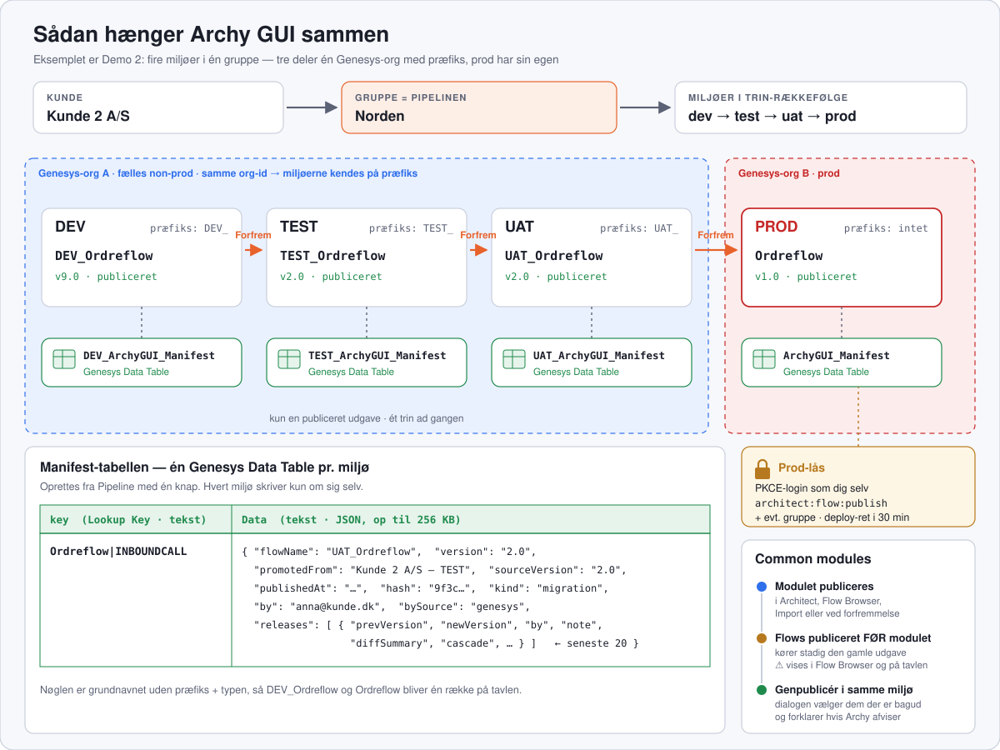

En **kunde** har én eller flere **grupper**, og hver gruppe er en **pipeline** af miljøer: dev → test → uat → prod. Et miljø er én Genesys-org set gennem én OAuth-klient. Deler flere miljøer samme org, kendes de på et **præfiks** i flownavnet. Flows **forfremmes** ét trin ad gangen, og hvert miljø holder sin egen historik i en **manifest-tabel** — en Genesys Data Table i org'en. Prod er låst bag et personligt login, og ændres et **common module**, genpubliceres de flows der bruger det, i samme miljø.

### Funktioner

#### 🏢 Kunder
Nye miljøer oprettes altid med **🌐 OAuth (PKCE)**: du logger ind i Genesys som dig selv, kun Client ID gemmes, og tokenet lever kun i serverens hukommelse. Ældre miljøer med **🔑 Client Credentials** (Client ID + secret i `customers.json`) virker stadig og er markeret med **gult**.

**⚙ Indstillinger** på hvert kort rummer navn, kunde, gruppe, trin, præfiks, org-navn, farve, division, godkendelse og krav til prod. Felterne tjekkes når de gemmes (se Sikkerhed), og omdøbes et miljø, flytter dets eksportmappe med.

**Hjælp ved hvert felt.** Alle felter — både når man opretter et miljø og under ⚙ Indstillinger — har en etiket og et **ⓘ**. Hold musen over ⓘ for at se hvad feltet bruges til, eller klik for at folde forklaringen ud under etiketten.

**Godkendelse og Client ID.** *Godkendelse* viser miljøets nuværende valg — nye miljøer får altid OAuth (PKCE), og står et ældre miljø på client credentials, siger en note at PKCE anbefales. Client ID står udfyldt, og under feltet vises **navnet på OAuth-klienten i Genesys** og dens type, så man kan finde den igen blandt kundens klienter (kræver login og `oauth:client:view`). Feltet til secret vises kun ved client credentials, og deploy-kravene kun på prod.

**🔌 Test** kontrollerer forbindelsen og **rettighederne**. Programmet slår miljøets faktiske rettigheder op — for en person (PKCE) direkte, for client credentials via klientens roller — og holder dem op mod hver funktion: læse, importere og publicere flows, Archy, datatabeller og manifest, Data Actions, prompts, divisioner, køer, brugere og afhængigheder. Kortet viser en liste med ✓ og ✗ og de rettigheder der mangler. Kan klientens roller ikke læses (kræver `oauth:client:view` og `authorization:role:view`), prøves læseadgangen af i stedet, og det der ikke kan prøves uden at skrive, står som *kunne ikke afgøres*. Fejler forbindelsen, står fejlen på kortet.

**📋 Opsætningsguide.** Knappen **📋 Opsætning** på et miljøkort — og et link når et nyt miljø er oprettet — åbner en tjekliste i sit eget vindue, som man kan have stående ved siden af Genesys: opret OAuth-klienten (grant type, PKCE), redirect-URI, miljøets felter her, log ind, rettighederne (listen over hvad programmet bruger), divisionen, manifest-tabellen og — på prod — deploy-retten. Punkter med **Tjek** kontrollerer programmet selv mod org'en; **▶ Tjek alt** kører dem alle. Resten krydser man af, og afkrydsningerne huskes pr. miljø i browseren. **Guiden kører *Tjek alt* af sig selv, når den åbnes**, og kortet viser, om den er gennemgået (`x af y`) — det gælder kun de punkter, programmet har kontrolleret mod org'en (eller du har afkrydset); at org'en kender miljøet er ikke nok. Så ser alle pc'er, der forbinder til samme kunde, det samme, og et miljø regnes først for rigtigt sat op, når rettigheder, klient, division og manifest er tjekket. Det sidste punkt, *Få flows ind i miljøet*, er valgfrit og tæller ikke med. Knappen **📋 Opsætning** er fremhævet, indtil guiden er gennemgået. **Er den ikke gennemgået, tilbydes den, når man har logget ind eller testet forbindelsen** — med valgene *Åbn guiden*, *Senere* og *Vis ikke igen for dette miljø*.

**🔎 Find det der allerede er sat op.** Efter login ser guiden efter ArchyGUI's egne tabeller i org'en. Er miljøet sat op fra en anden pc, står det dér — med navn, kunde, gruppe, trin og præfiks — og **Brug dette** tager det i brug uden at skrive noget. **Opret nyt ud fra dette** laver et nyt miljø i samme org med den fundne opsætning som skabelon; du vælger trin og præfiks, og præfikser der allerede bruges, afvises. Er der intet i org'en, vælger du mellem **Kun import/eksport** og **Start en pipeline**. Et kort for et miljø i **samme org**, som pc'en ikke har endnu — fx dev, når man starter med prod — kan tilføjes med **Tilføj som nyt miljø**: det bliver et ekstra PKCE-miljø med opsætningen fra org'en, og intet skrives i org'en. Opsætningen nævner også pipelinens miljøer i **andre orgs** — fx prod — og de kan tilføjes herfra med ét klik; org-id'et sættes med det samme, så login'et afvises hvis man vælger en forkert org.

**Kun import/eksport.** Et miljø uden trin er ikke med i nogen pipeline. Det kan importere og eksportere flows som alle andre, men ArchyGUI opretter ingen tabel og skriver intet i dets org.

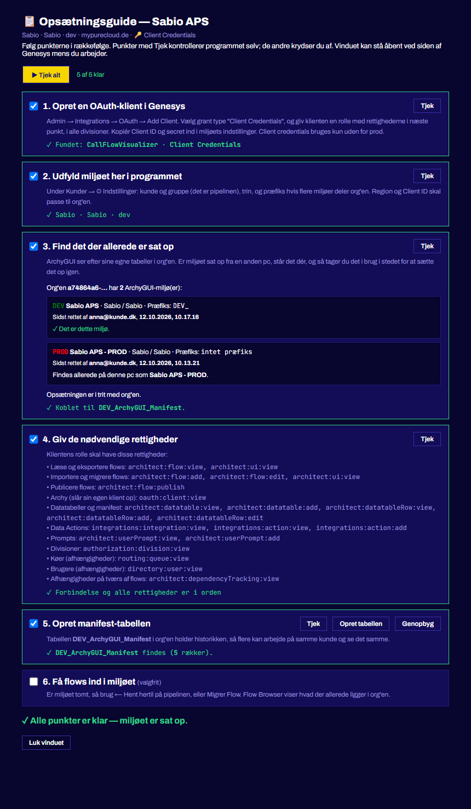

**Log ind hvor du står.** Mangler et miljø login, kommer der en bjælke øverst med en **Log ind**-knap — på alle sider, ikke kun Kunder — og siden hentes igen bagefter. 🔒 ved miljøet i sidebjælken logger også ind; 🟢 når man er logget ind. Hold musen over 🟢 — eller se login-mærket på kortet — for at se hvilken org man er logget ind i.

**Mange kunder.** Søgefeltet over kortene finder på navn, kunde, gruppe, trin og org-navn, og *Kun dem der kræver login* viser dem man mangler. Kortene sorteres efter kunde og trin, og formularen og demo-kunderne er foldet sammen.

**Kunde → gruppe → miljø.** Én post er ét *miljø*. To niveauer ovenover afgør hvad der må migreres indbyrdes:

```
Vattenfall            Kunde 2 A/S
├── DE   test → prod  └── Norden   dev → test → uat → prod
└── SE   test → prod
```

**Gruppen er pipelinen** — om den hedder et land eller et firma er kun en etiket. Hvert miljø får et trin fra `dev → test → uat → prod`. Har en kunde kun én gruppe, skjules valget.

**Egne trin.** Under **Kunder → Trin** kan listen udvides med fx `staging` eller `preprod` og sorteres med pilene. Listen gælder for hele programmet og gemmes i `settings.json`. **Prod står altid sidst**, fordi login, deploy-ret og skrivevagten hænger på den, og et trin der bruges af et miljø, kan ikke fjernes. Egne trin får gul farve — orange hvis de står lige før prod.

**Præfiks: flere miljøer i den samme org.** Nogle kunder har ikke én org pr. miljø, men **én org hvor miljøerne kendes på et præfiks**:

| Miljø | Præfiks | Flow hedder | Manifesttabel |
|---|---|---|---|
| dev | `DEV_` | `DEV_Ordreflow` | `DEV_ArchyGUI_Manifest` |
| test | `TEST_` | `TEST_Ordreflow` | `TEST_ArchyGUI_Manifest` |
| uat | `UAT_` | `UAT_Ordreflow` | `UAT_ArchyGUI_Manifest` |
| prod | *(tomt)* | `Ordreflow` | `ArchyGUI_Manifest` |

Opret ét miljø pr. præfiks. Programmet slår **org-id'et** op i Genesys og ser dermed at de deler org — også når de bruger hver sin OAuth-klient, fx dev med client credentials og prod med PKCE. Et PKCE-miljø får sit org-id ved første login, og et kendt org-id bliver aldrig overskrevet. Hvert miljø ser kun sine egne flows i Flow Browser, Export og på tavlen. Prod uden præfiks tager alt der **ikke** bærer et søskendepræfiks — ellers ville prod se hele orgen.

> **Præfikset skal ramme præcist.** Et flow der hedder `DEV Noget` med mellemrum i stedet for `DEV_Noget` hører til prod, ikke dev.

**Org-navn** er kun en etiket til overskriften på pipelinen, så man kan se hvilke miljøer der bor i samme org.

**Farve.** Hvert miljø vises i sit trins farve — dev grøn, test gul, uat orange, prod rød — på pipelinen, i sidebjælken og på kortene. Under ⚙ Indstillinger kan man vælge en anden.

**Rigtig org ved login.** Med trusted orgs vælger man selv org'en på Genesys' login-side. Login'et tjekker hvilken org det landede i, og afviser det hvis den ikke passer med miljøets — eller hvis den hører til en anden kunde. Org'en står ved miljøet når man er logget ind.

**Demo-kunder.** To knapper opretter et komplet opsæt der kun findes lokalt — ingen credentials, ingen kald til Genesys eller Archy:

| Demo | Opsæt |
|---|---|
| **Demo 1** | fire orgs, ét miljø i hver |
| **Demo 2** | `DEV_`, `TEST_`, `UAT_` deler én org; prod har sin egen og intet præfiks |

Begge kan være oprettet samtidig. `↺ Nulstil` sætter tilbage, `✕ Fjern` sletter miljøer, flows og manifestlinjer.

#### 📋 Flow Browser
Hent, søg og filtrer miljøets flows. Filtrér på **flowtype** (listen fyldes ud fra de typer miljøet faktisk har, med antal pr. type) og på fritekst. Klik **Export** direkte fra listen.

**⚠ Common modules der er nyere end deres flows.** Hver gang listen hentes, tjekkes om et common module er publiceret *efter* et flow der bruger det — så kører flowet stadig på den gamle udgave. Det står i et gult felt pr. modul med en **🔁 Genpublicér dem**-knap, og rækkerne er mærket ⚠. Publicerede common modules har desuden en **🔁 Brugere**-knap (se [Common modules](#-common-modules)).

**🚀 Publicér.** Flows der er migreret med handlingen `create` ligger som checked-in draft uden at være i drift. De får en **Publicér**-knap der publicerer den version der allerede er i org'en — uden at hente noget fra kilden igen. Er det et common module, tilbydes du bagefter at genpublicere de flows der bruger det. Flows der er tjekket ud af en bruger vises som **Udtjekket** i versionskolonnen.

**⇄ Sammenlign to orgs.** Vælg en org i *Sammenlign mod org*, og hver række får en ⇄-knap. Den eksporterer flowet fra begge orgs og sammenligner **indholdet** — ikke versionsnumrene, som er per-org tællere og intet siger om hvad flowet indeholder.

| Udfald | Betydning |
|---|---|
| ✓ Identisk indhold | Samme flow, uanset at der står fx v37 og v1 |
| ⚠ N forskelle | De første vises linje for linje |
| ⚠ Findes ikke i mål-org'en | Flowet mangler helt |

Dialogen viser desuden hvornår hver side sidst blev **publiceret** og af hvem, og — hvis flowet er migreret med dette værktøj — hvilken org og hvilken kildeversion målet er bygget af.

**📌 Sæt nulpunkt.** Noterer hvordan sammenlignings-org'ens flows ser ud nu. Derefter kan værktøjet fange at nogen har publiceret direkte i mål-org'en, **også for flows det aldrig selv har migreret**. Kør den én gang pr. par af orgs du arbejder med — fx `dev → uat` og `dev → prod` for hver kunde.

> Oplysningerne gemmes i `flows/.migrations.json`, nøglet på Genesys' org-id. **Filen er maskinspecifik og deles ikke** — arbejder I flere på samme kunde, så opret det delte manifest i org'en i stedet (se [Pipeline](#-pipeline)).

#### 🚦 Pipeline
Er der sat grupper op, **starter programmet her**, med den kunde man sidst arbejdede med valgt. Tavlen hentes først når man trykker *Vis pipeline* — den kalder alle gruppens orgs.

Vælg kunde og gruppe, og få gruppens miljøer som kolonner i trin-rækkefølge med flows som rækker. Miljøer der bor i **samme org** samles under orgens navn. Hver kolonne har miljøets farve i overskriften (se Farve under Kunder); selve cellerne farves ikke, for rød betyder allerede at noget er galt.

Hver celle viser flowets **navn i netop det miljø**, dets publicerede udgave og hvornår. Versionstallene kan **ikke** sammenlignes på tværs — de er per-org tællere — så de er kun til orientering.

| Farve / mærke | Betydning |
|---|---|
| grøn | publiceret, og intet tyder på at det kom udenom |
| ✗ **publiceret uden om pipelinen** | manifestet siger vi efterlod miljøet på v*N*, og det står højere. Gælder kun et miljø der *modtog* flowet — arbejde i dev er ikke at gå udenom |
| ✗ **N udgaver foran trinnet før** | miljøet er publiceret flere gange end det trin der fodrer det. Et fingerpeg, ikke bevis |
| ⚠ **N udgaver ikke forfremmet** | der er arbejdet videre uden at skubbe det videre |
| ⚠ **findes kun i et senere trin** | bygget udenom kæden |
| ? **ukendt** | org'en kunne ikke læses — vi ved ikke hvad der er i den |

**Forfremmelse** går ét trin ad gangen og lander på *Migrer Flow* med kilde, mål og flow sat, så afhængighedstjek og divisionsvalg er som ellers. Kun en **publiceret** udgave kan forfremmes — en kladde er ikke testet. Til prod kræves dit prod-login (se Sikkerhed).

**Hver knap siger hvad den gør, før den gør det.** ⟶ Forfrem, ⟵ Hent hertil, ⟵ Hent tilbage, ↩ og ▲ Publicér (demo) åbner en dialog med flowet, fra- og til-miljøet, hvad der sker trin for trin, og hvad man skal passe på: at målet er prod, at målet er publiceret uden om pipelinen eller er flere udgaver foran — så de ændringer går tabt — eller at ⇄ Tjek indhold har fundet en forskel. Man vælger **Udfør** eller **Annullér**. **? Knapperne** i tavlens værktøjslinje forklarer alle knapper.

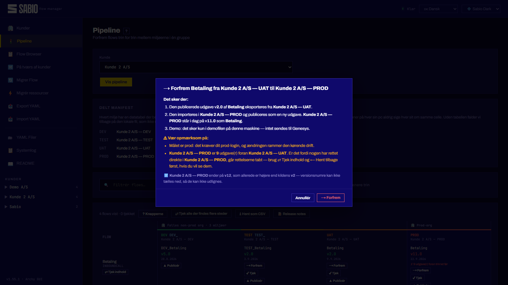

*⟶ Forfrem til et prod der er 9 udgaver foran: dialogen siger hvad der sker, advarer om at rettelser i prod går tabt, og at versionen ikke kan udlignes.*

**Versionsudligning.** Hver publicering giver én ny udgave, og tælleren er pr. org — så efter en forfremmelse står målet typisk lavere end kilden (dev v10 → test v3). Dialogen for ⟶ Forfrem og ⟵ Hent hertil regner ud hvad målet ender på, og tilbyder at **udligne** (ved *Hent hertil* er det slået til fra start, så et flow der hentes ned i dev, ikke starter på v1.0 når det står på v5.0 i prod): målet publiceres det antal ekstra gange der mangler, med samme indhold, så det står på kildens nummer. Samme valg findes på *Migrer Flow* som *Udlign versionsnummer med kilden*, når handlingen er publish. Står målet allerede højere — som et prod der er løbet foran — kan det ikke tælles ned, og det siges. Højst 25 ekstra publiceringer pr. flow.

**Common modules tjekkes også på tavlen.** Når den er hentet, tjekkes hvert miljø i gruppen: øverst står fx *⚠ Sabio APS - PROD: 2 common module(s) er nyere end 1 flow(s) der bruger dem*, modulets celle er mærket *⚠ N flow(s) ikke genpubliceret* med en gul 🔁, og flowets celle *⚠ ældre end …*. Kan et miljø ikke tjekkes — fx prod uden login — siges det.

**Navnet bærer sin historik.** Ved forfremmelse får flowet kildens udgave sat på — `Ordreflow` → `Ordreflow_v10` — i **både** kilde og mål. Arbejder man videre i dev og publicerer, bliver navnet stående på `_v10` indtil næste forfremmelse. Så kan man på navnene alene se hvilket trin der er bagud.

Tallet sættes kun når flowet forlader **gruppens første trin**. Videre fra test, uat og prod følger navnet med som det er — `DEV_Betaling_v6` bliver `TEST_Betaling_v6`, `UAT_Betaling_v6` og `Betaling_v6`, uanset hvor mange gange hvert miljø selv har publiceret. **Common modules og bot flows får aldrig en endelse**: de kaldes ved navn fra andre flows, og et nyt navn ville knække hvert kald.

**UAT uden præfiks.** Et miljø kan godt stå uden præfiks i en org det deler med præfiksede søskende — fx `DEV_` og `TEST_` i den ene org, UAT uden præfiks ved siden af, og prod i en anden org. Så hedder flowet det samme i UAT og prod. UAT tager da alt i org'en der ikke bærer et søskendepræfiks. Kun **ét** miljø pr. org kan være uden præfiks; serveren afviser et andet.

**Ændrer man præfikset** på et miljø, viser værktøjet en plan før det gemmer: hvilke **flows**, **datatabeller** og hvilken **manifest-tabel** der skal have nyt navn, fx `UAT_Betaling` → `Betaling`. Man fjerner flueben ved det der ikke skal med, og trykker *Omdøb og gem*. Navnene ændres via Genesys' API — ikke via Archy, som finder flows på navnet og ville lave et nyt ved siden af — så flowene beholder deres id, alle udgaver får det nye navn, og det der peger på dem, virker videre. Et navn der allerede findes, springes over. Fejler én omdøbning, rulles de andre tilbage, og præfikset ændres ikke. Common modules og bots er markeret: de kaldes ved navn i eksporteret YAML, så gemte filer og andre værktøjer skal rettes i hånden.

**Vejen tilbage.** Findes flowet kun senere i kæden — fx alt hvad der ligger i prod, når dev lige er sat op — får cellen en **⟵ Hent hertil**-knap der henter det fra det nærmeste senere trin. Har miljøet et præfiks, får flowet det på undervejs: `Bank bot` fra prod bliver til `DEV_Bank bot`. Datatabeller behandles på samme måde.

**⚙ FDA** og **✗ FDA mangler her** viser Function Data Actions på tavlen, så man ser dem, før man forfremmer. Et flow der bruger en Function Data Action, får et gult *⚙ FDA* med navnene som tooltip. Bruger flowet i miljøet til venstre en, som ikke findes i dette miljø, står der et rødt *✗ FDA mangler her* — og forfremmelsen er blokeret, til den er oprettet i Genesys. Oplysningerne kommer i baggrunden fra Genesys' afhængighedssporing, ét opslag pr. Function Data Action, og tavlen tegnes igen, når de er der. Sporingen kender kun den **publicerede** udgave og kan være få minutter bagud efter en publicering. Et flow der kun bruger en FDA gennem et common module, får ikke mærket — modulet gør.

**✔ Tjek** står ved ⟶ Forfrem og kører første fase af en forfremmelse — eksporterer flowet fra kilden og undersøger alt det refererer til i målet — men importerer intet og skriver intet i mål-org'en. Svaret er en rapport i tre grupper: det der **blokerer** forfremmelsen (en Function Data Action der ikke findes i målet, eller en data action der hverken findes i kilden eller målet), det der **skal afklares** (en data action der findes under en anden kategori i målet — vælges ved forfremmelsen eller i Totaltjek), og det der **håndteres undervejs eller i hånden** (tabeller og actions der kan migreres med, køer og andet der skal oprettes i målet). Tjekket bruger den samme undersøgelse som forfremmelsen, så de to aldrig er uenige; blokeringerne er de samme som stopper selve forfremmelsen. Tjekket er ikke et krav: man kan forfremme uden at have kørt det. Det virker ikke på demo-miljøer.

**⇄ Tjek indhold** eksporterer flowet fra hvert miljø og sammenligner hashen — det eneste der kan afgøre om to miljøer er ens. Afviger de, kommer der en **⟵ Hent tilbage**-knap den anden vej, så man kan hente virkeligheden ned og se hvad der blev lavet.

#### 📝 Release notes og rollback
Hver forfremmelse skriver en **release** med hvad målet indeholdt før og efter, hvem der gjorde det, og hvilke referencer der blev skrevet om. Cellen på tavlen får et **📝 N**-link til flowets historik i det miljø, og værktøjslinjen en **📝 Release notes**-knap for hele gruppen.

- **Diff'en** viser de linjer der faktisk er ændret — trackingId'er og andet eksportstøj er renset væk. En note (fx sagsnummer) kan skrives på hver release.
- **Kopiér markdown / Hent .md** giver noterne klar til en change request eller mail — én release eller alle valgte.
- **↩ Rul tilbage** publicerer indholdet fra før seneste forfremmelse igen, som en ny udgave. Næste klik går én forfremmelse længere tilbage (`_v6` → `_v5` → `_v4`). Prod kræver bekræftelse som ved en forfremmelse. I demoen går navnet tilbage med; i en rigtig org beholder flowet sit navn, for et andet navn i YAML'en ville få Archy til at oprette et nyt flow ved siden af.

**Hvor det gemmes.** Historikken ligger i **org'en**, i miljøets manifest-tabel (`ArchyGUI_Manifest`), i rækken for flowet: de seneste 20 releases med udgaven før og efter, hvem, hvornår og noten. *Indholdet* gemmes ikke dér — Genesys har allerede hver publiceret udgave, så en rollback eksporterer bare den udgave målet stod på før, direkte fra org'en. Derfor kan man forfremme fra én pc og rulle tilbage fra en anden.

Den lokale `flows/.releases.json` (og indholdet i `flows/.releases/`) er en **cache**: den har diff'en klar, så man slipper for eksporten. Mangler den — fordi releasen blev lavet fra en anden pc — bygges diff'en af de to udgaver i org'en, første gang man folder den ud. Har et miljø **ingen manifest-tabel**, findes historikken kun på den pc der lavede releasen, og listen markerer den *kun på denne pc*.

For at kende "før" eksporteres målets publicerede udgave inden importen — én ekstra Archy-eksport pr. forfremmelse.

#### 🔁 Common modules
Et common module slår først igennem i de flows der kalder det, **når de publiceres igen**. Forfremmes et modul (med handlingen *publish*), finder værktøjet de flows i målmiljøet der bruger det — via Genesys' afhængighedssporing, også gennem et andet modul — og tilbyder at genpublicere dem. Den publicerede udgave genpubliceres, ikke en kladde; har et flow en upubliceret kladde, er det fravalgt som standard, for kladden ville blive erstattet. Modulets release-note får listen med.

Samme tilbud kommer når et modul **publiceres i Flow Browser**, **importeres med publish** eller **migreres**. **🔁 Genpublicér brugere** på tavlen og **🔁 Brugere** i Flow Browser gør det samme til når modulet er rettet direkte i Architect — og begge steder vises det af sig selv når et modul er nyere end de flows der bruger det. I dialogen er de flows valgt der kører på en ældre udgave; dem der allerede er publiceret efter modulet, står der men er ikke valgt.

**Når en genpublicering fejler.** Genpublicering tager den publicerede udgave og publicerer den igen — og så tjekkes flowet mod org'en som den er i dag. Dialogen bliver stående med én linje pr. flow: hvad der er galt og hvad man gør ved det — en TTS-stemme org'en ikke har, ingen standardstemme for et sprog, en kø, bruger, tabel, data action, prompt, tidsplan eller et flow der ikke findes længere (og hvor i flowet), et tomt felt der skal udfyldes, eller et låst flow. Archys rå tekst og stien til dens debug-log står under *Detaljer fra Archy*.

**Filtre.** Fritekst på flownavn, **flowtype** (listen fyldes ud fra de typer gruppen faktisk har, med antal), og *Kun dem der mangler i et senere trin*. De virker sammen.

**⭳ Hent som CSV** henter præcis de rækker der vises — også efter et typefilter — med semikolon og UTF-8 BOM så dansk Excel åbner den i kolonner.

**Vagter, håndhævet på serveren:** migrering på tværs af grupper er spærret; prod kræver en bevidst bekræftelse **og et personligt login med rettigheden** (se Sikkerhed); kilden skal være publiceret; kilde og mål må ikke være samme miljø.

**Delt manifest.** Hvert miljø kan have en **Genesys Data Table** i sin org — den samme slags tabel man ser under *Architect → Data Tables* — der hedder `ArchyGUI_Manifest`, med præfiks hvis miljøet har et. Den beskriver **sig selv**: hvad org'en indeholder, hvornår det kom hertil og hvem der gjorde det. Fordi hver org kun skriver om sig selv, kan to personer på hver sin pc aldrig sige hver sit om samme celle. Tabellen oprettes med knappen under *Delt manifest* på Pipeline eller fra opsætningsguiden, aldrig af sig selv, og kræver rettigheden `architect:datatable:add`. Uden tabellen falder værktøjet tilbage på en lokal fil, som ikke er delt.

Tabellen har to kolonner:

| Kolonne | Type | Indhold |
|---|---|---|
| `key` | tekst (Lookup Key), op til 256 tegn | Flowets **grundnavn uden præfiks** og typen: `Ordreflow\|INBOUNDCALL` |
| `Data` | tekst, op til 256 KB | JSON med hvad miljøet indeholder og dets historik |

Én række pr. flow. `Data` for `UAT_Ordreflow` ser fx sådan ud:

```json
{
  "flowName": "UAT_Ordreflow",
  "version": "2.0",
  "publishedAt": "2026-09-08T10:12:00Z",
  "promotedFrom": "Kunde 2 A/S — TEST",
  "promotedAt": "2026-09-08T10:12:00Z",
  "sourceVersion": "2.0",
  "hash": "9f3c…",
  "kind": "migration",
  "by": "anna@kunde.dk",
  "bySource": "genesys",
  "at": 1788516720000,
  "releases": [
    { "id": "…", "at": 1788516720000, "kind": "migration", "sourceName": "Kunde 2 A/S — TEST",
      "prevVersion": "1.0", "newVersion": "2.0", "by": "anna@kunde.dk", "note": "CHG-1234",
      "diffSummary": { "added": 4, "removed": 1 }, "cascade": [], "rolledBackBy": null }
  ]
}
```

`by` er Genesys-brugeren når miljøet er logget ind med PKCE (`bySource: "genesys"`), ellers pc-brugeren (`"machine"`). `releases` holder de seneste 20 forfremmelser, genpubliceringer og rollbacks — det er dem **📝** og **↩** bygger på. Ret ikke rækkerne i hånden; værktøjet skriver dem.

> **Ét manifest pr. miljø, ikke pr. org.** Deler flere virtuelle miljøer den samme org, skal hvert af dem have sin egen tabel: `DEV_ArchyGUI_Manifest`, `TEST_ArchyGUI_Manifest`, og `ArchyGUI_Manifest` for prod.
>
> Rækkenøglen er nemlig **grundnavnet uden præfiks** — `WeekNumber|INBOUNDCALL` — så tavlen kan parre `DEV_WeekNumber` og `WeekNumber` som én række. I én fælles tabel ville de to miljøer derfor skrive på samme nøgle og overskrive hinanden, og begge celler ville vise det samme.

**Opsætningsrækken.** Ud over én række pr. flow har tabellen én række med nøglen `ArchyGUI_Setup`, der beskriver miljøet selv: navn, kunde, gruppe, trin, præfiks, farve, division, deploy-krav, region, org-id, et fast `pipelineId`, kundens trinliste, de præfikser org'en bruger, og pipelinens andre miljøer — også dem i andre orgs. Det er den rækken som en ny pc finder miljøerne med. Den indeholder **ingen hemmeligheder**: ingen secret og intet token, og Client ID kun for PKCE-klienter. Den skrives automatisk, når tabellen oprettes, når et miljø oprettes, rettes eller slettes i pipelinen, og første gang et ældre miljø skriver til sit manifest — i alle pipelinens orgs, men i prod kun med et login der må deploye; ellers venter den, og kortet viser *⚠ Opsætningen er ikke skrevet til org'en*.

**Org'en vinder.** Ved login, 🔌 Test og når Pipeline åbnes, hentes org'ens opsætning ind, og det der er ændret, vises én gang øverst på siden. En rettelse her på pc'en skrives derfor straks til org'en. Har nogen ændret org'ens række, mens en rettelse herfra ventede, vælger man i guiden hvem der har ret. **Prod-vagten løsnes aldrig udefra:** org'en kan ikke sætte et prod-miljø til et andet trin eller ændre dets deploy-krav — det bliver en uenighed, og at tage org'ens kræver prod-login. Trin org'en har og pc'en mangler (fx staging), lægges til listen; der fjernes aldrig nogen. Et miljø uden præfiks tager aldrig flows med et præfiks org'en bruger — heller ikke på en pc hvor dev og test ikke er tilføjet.

**Tavlen følger med.** Mens Pipeline er åben, spørger programmet hvert minut til et fingeraftryk af manifest-tabellerne i den viste gruppe, og ændrer det sig — fx fordi en kollega på en anden pc har forfremmet et flow — tegnes tavlen igen af sig selv. Det samme sker, når man vender tilbage til Pipeline efter en migration. Intervallet sættes med `pipelineRefreshSeconds` i `settings.json` (mindst 15; `0` slår det fra). **Fra tavlen til Migrer** (*Hent hertil*, *Forfrem*) vises kun det valgte flow; vil man migrere flere, slår man *Vis kun valgte* fra.

**Genopbyg.** Mangler et miljøs tabel, står det som en gul advarsel lige over tavlen på Pipeline — med en **Genopbyg**-knap. Er tabellen slettet, opretter **Genopbyg** (under *Delt manifest* og i guiden) den igen, skriver opsætningen og en række pr. flow i miljøet. Rækker der står, røres ikke. Hvad org'en indeholder nu, kan altid læses i Genesys; historikken — hvem forfremmede hvad hvorfra — tages fra denne pc's lokale filer, hvor den findes. Rækker uden historik er et nulpunkt, og svaret siger hvor mange der fik historik med.

#### 🔀 På tværs af kunder
Viser de flows der findes hos **flere kunder** — fx det samme common module i dev, uat og prod. Hver kunde vises med sin version, publiceringstidspunkt og om flowet er aktivt.

Oversigten bygger på ét API-kald pr. kunde og er derfor hurtig. **⇄ Sammenlign indhold** på en række eksporterer flowet fra hver kunde og sammenligner indholds-hashen — det tager tid, så det køres kun for den række du beder om.

> Begge niveauer er nødvendige: to kunder kan stå med samme versionsnummer og alligevel have forskelligt indhold, fordi numrene tælles pr. org.

#### 🔄 Migrer Flow
Vælg kilde, mål og flows. **Import handling** og **🚀 Kør Migration** står over flowlisten, så de kan nås uden at rulle forbi hundredvis af flows. Migreringen kører i to faser:

1. **Tjek** — flowet eksporteres fra kilden, og mål-org'en undersøges for alt flowet refererer til. Der skrives intet til mål-org'en i denne fase.
2. **Import** — først efter dit valg importeres flowet.

Mangler der noget, åbnes en dialog med to sektioner:

| Sektion | Indhold | Handling |
|---|---|---|
| Kan migreres nu | DataTables, Data Actions, **common modules**, bot flows, transfer-mål, **user prompts**, **scripts** | Afkrydsning — migreres inden flowet |
| Kræver et valg | **Division** (opret / brug Home / spring over), **survey form** (kopiér / spring over), **TTS-motor** målet ikke har (erstat med målets TTS / spring over) | Rullemenu pr. ressource |
| Skal oprettes manuelt | Køer, **brugere** (fast bruger i *Transfer to User*), skills, wrap-up-koder, schedules, knowledge bases, Function Data Actions | Oprettes i mål-org'en først |

Common modules migreres med samme maskineri som flows, og deres **egne** afhængigheder tages først — rekursivt, nedefra og op. Et modul der selv bruger femten tabeller får dem alle med — og det samme gælder dets data actions (også *secure* data actions), user prompts og scripts.

**Divisionen flowet oprettes i** tjekkes før noget importeres. Må login'et ikke oprette flows i den, stopper flowet med en besked om hvilken division det gælder — giv rollen adgang i divisionen, eller sæt en division på målmiljøet. Ligger et common module i en division der ikke findes i målet, lægges det i målmiljøets division (Home, hvis der ingen er sat).

**TTS-motorer** flowet taler med (fx *Microsoft Azure*), som målet ikke har, vises i dialogen sammen med de sprog de bruges til. Vælger du *Erstat med målets TTS*, skiftes hvert sprog til en stemme på samme sprog i en motor målet har — Genesys' egen foretrækkes — både i flowet og i de moduler der migreres med. Sprog målet ikke har en stemme til, står som *Ingen stemme i målet*; dem kan erstatningen ikke klare, og de skal have en stemme i målet først.

**Tomme skaller fra en fejlet import.** Archy opretter flowet, før indholdet lægges ind. Fejler importen, ligger der et tomt flow i målet (version 1.0 med kun *Disconnect*), som aldrig er publiceret. Et common module, bot flow eller transfer-mål regnes derfor kun for at findes, når det er **publiceret** — så en tom skal migreres igen i stedet for at blive sprunget over.

**Kan målet ikke læses** — fx fordi OAuth-klienten mangler et scope — står ressourcen som *kunne ikke tjekkes* med fejlen under, og den tilbydes ikke migreret.

> **Function Data Actions blokerer.** Bruger flowet en Function Data Action, der findes i kilden men ikke i målet, kan den ikke oprettes herfra, og forfremmelsen **standses**: dialogen viser den i rødt med en **tjekliste til kopiering**, og de to knapper *Fortsæt uden* og *Migrér valgte* er skjult. Opret den i Genesys i mål-org'en, og tryk **Tjek igen**; først når den findes, kan flowet forfremmes. Spærringen står også i selve importen, så den ikke kan springes over. Det holder versionsnummer og tjek i takt, i stedet for at man retter bagefter direkte i Genesys.

> **Data actions får målets navne.** Et flow peger på en data action med **kategori** (integrationens navn) og **navn**. Hedder de noget andet i mål-org'en — fx *Test - Genesys Cloud Data Actions* i test og *Genesys Cloud Data Actions - Flows* i prod — fejler importen, selv om navnet findes. Archy slår derfor begge dele op i målet, og findes en af dem ikke præcist, åbnes en liste over flowets data actions: *samme* (findes), *gemt valg*, *vælg* (samme navn under en anden kategori — vælg hvilken) og *findes ikke* (peg den over på en eksisterende, eller lad den blive migreret i næste trin). Referencen i flowet skrives om på den side-kopi der importeres; kildens egen kopi røres ikke. Valgene gemmes pr. org-par — i mål-org'ens manifest-tabel hvis den har en, ellers i `.data-action-map.json` — og gemmes først efter en vellykket import, så de bruges automatisk næste gang. Vil du ikke have dem gemt, fjern kryds i *Husk mine valg*. Et gemt valg kan ikke fjernes fra brugerfladen endnu.

Du kan vælge **Migrér valgte og fortsæt**, **Fortsæt uden** (flowet importeres selvom noget mangler — det fejler typisk i Architect bagefter) eller **Spring flowet over**.

> **Skills der slås op dynamisk kan ikke tjekkes.** Bruger flowet `FindSkill(Task.Skills)`, afgøres skillet først når flowet kører. Dialogen siger det, men du må selv kontrollere at skillene findes i mål-org'en. Det samme gælder en bruger eller kø der er givet som udtryk (`targetUser: exp: Task.bruger`) — findes den ikke, går opkaldet ad flowets fejlvej, ikke importen.

Alt hvad der mangler skrives også til **Systemloggen**, så du kan finde det igen bagefter.

> **Når Archy fejler uden at sige hvorfor.** Nogle fejl ender som `Architect Scripting session ended in error ( code: 99 )` — Archys generiske afslutning, der intet forklarer. Beskeden bærer derfor stien til Archys egen fulde udskrift:
>
> ```
> Architect Scripting session ended in error ( code: 99 )
>   — full Archy output: C:\Tools\Archy\archyHome\debug\archy-debug-….txt
> ```
>
> Den fil indeholder hele kørslen. Archy skriver én pr. kald.

#### 📤 Export YAML
Eksporter ét flow eller hele miljøet med live fremgangsindikator. Listen over miljøets flows vises så snart miljøet er valgt; skriv for at filtrere. `*` viser alle, og en stjerne inde i teksten er et jokertegn — `DEV_*log` finder `DEV_Create Logitems`. Deler flere miljøer org'en, eksporteres kun dette miljøs egne.

#### 📥 Import YAML
- Indsæt YAML manuelt, upload `.yaml`-fil eller drag-and-drop
- **🔍 Valider YAML** — syntax-tjek i browseren (ingen API-kald)
- **🌐 Tjek mod org** — tjekker om alle ressourcer (division, køer, DataTables, Data Actions, Prompts) eksisterer i mål-org'en *inden* import
- Publicerer du et **common module**, tilbydes du bagefter at genpublicere de flows der bruger det. Import til prod kræver dit prod-login

#### ⚡ Migrér ressourcer
Siden migrerer det der ikke er flows mellem to orgs, fordelt på otte faner: **Data Actions**, **Data Tabeller**, **Wrap-up-koder**, **Roller**, **OAuth-klienter**, **Integrationer**, **User Prompts** og **Scripts**. Kilde- og mål-org vælges ét sted og deles af alle.

**Fanen Data Actions:**
1. Vælg **kilde-org** og **mål-org**
2. Vælg **kilde-integration** → kun actions fra netop den integration vises
3. **Mål-integrationen** foreslås automatisk — tjek noten over listen
4. Markér de actions du vil kopiere → klik **⚡ Migrér valgte**
5. Loggen viser pr. action: ✓ Oprettet og publiceret / ⚠ Allerede eksisterer / ✗ Fejl, og slutter med en opsummering

> **Hvorfor vælges der integration?** Data Actions hører til en integration, og en org kan have flere af samme type — fx flere OAuth-integrationer der grupperer actions og spreder belastningen. Ved at vælge én ad gangen bevares grupperingen i mål-org'en. Markeringen ryddes automatisk når du skifter integration, så du ikke kommer til at migrere på tværs af grupper.
>
> Mål-integrationen matches på navn, ellers på integrationstype hvis der kun er én kandidat. Er der flere mulige, skal du selv vælge — og migreringen kan ikke startes før du har gjort det.

**Fanen Totaltjek** sætter hver data action i kilden op mod mål-org'en, på kategori og navn, så man kan afklare navnene før man migrerer flows. Et klik på et tal filtrerer listen: *matcher*, *gemt valg*, *skal vælges* (samme navn under en anden kategori), *mangler* og *FDA mangler* (en Function Data Action kan ikke oprettes herfra). Til hver række kan man pege den over på den action i målet, den skal bruge — *Brug forslag* tager alle rækker med præcis én kandidat — og **Gem kortlægning** gemmer det, eller fjerner et gemt valg, for hele org-parret. Det er den samme kortlægning som listen i flowet bruger. **Tjek kontrakter** henter input- og output-skemaet fra begge sider for dem der matcher og viser felter der mangler, er ekstra eller har en anden type eller et andet krav — en action kan hedde det samme og alligevel ikke passe til flowet; det tager 20 par ad gangen, så en stor org kan tage et øjeblik. Ligger de to miljøer i samme org, er der intet at sammenligne, og fanen siger det. Genesys' egne indbyggede actions (id'et begynder med `static_`) er ikke med, når de mangler i målet — de kan hverken oprettes eller migreres. Actions der mangler, migreres stadig på fanen Data Actions.

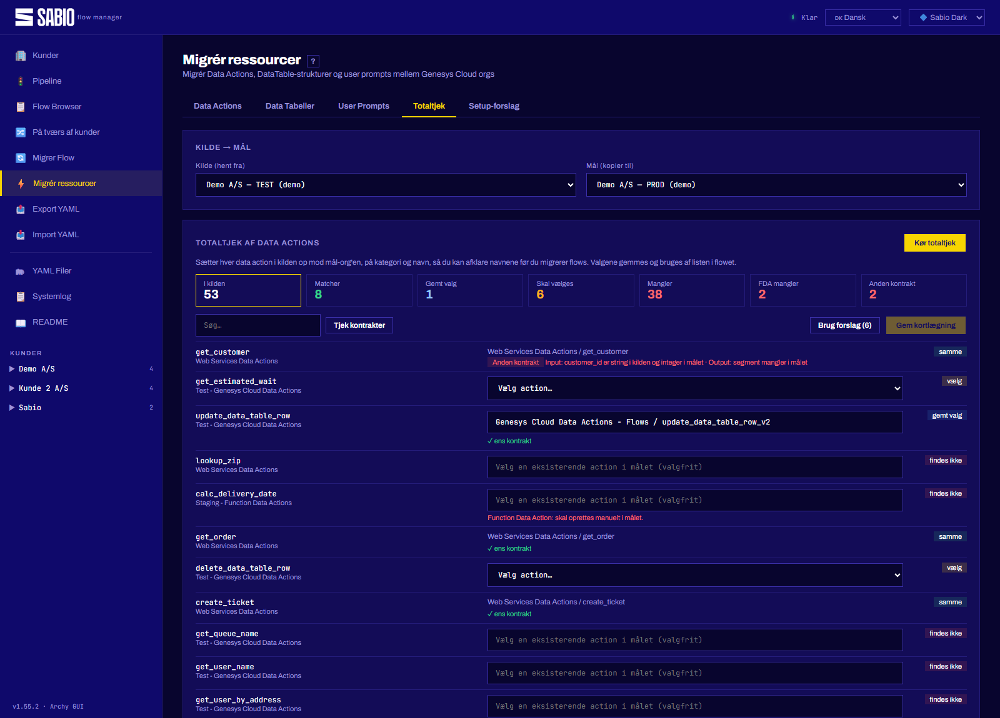

*Eksempel med opdigtede data (Demo A/S — TEST til PROD): billedet viser appens rigtige brugerflade, men svarene er beregnet af appens egne funktioner på en opdigtet org, ikke hentet fra en kunde. Faneblade kræver to forskellige orgs.*

**Fanen Setup-forslag** foreslår, hvilke integrationer i mål-org'en de data actions, der mangler, skal ligge i. Det er til dét tilfælde, hvor kilden har få integrationer og målet mange — og hvor en integration kun rummer et vist antal actions. Man angiver grænsen pr. integration (Archy kender den ikke; tallet huskes i browseren), og forslaget sætter de actions, der mangler helt og kan oprettes herfra, ind i de **aktive** integrationer af samme type, hvor der er plads. En kildeintegrations actions holdes samlet, hvis de er der plads til — helst i en integration med samme navn — ellers deles de. Inaktive integrationer foreslås aldrig, og findes der ingen aktiv integration af typen, siger forslaget hvad den skal hedde. Kapacitetsbjælkerne viser det, der findes, og det, der kommer til; en gruppe kan flyttes til en anden integration, og bjælkerne følger med. Function Data Actions og actions under en anden kategori er ikke med, men tælles og vises som *FDA manuelt* og *Skal vælges*. Forslaget kan eksporteres til **Excel** (CSV) eller en **printvenlig side** (Ctrl+P giver PDF) til samtalen med kunden; det indeholder kun navne og tal. **Migrér efter planen** opretter de actions, forslaget har placeret, i de foreslåede integrationer — én ad gangen, med mål-integrationen valgt for hver. Man bekræfter først (med antal og evt. integrationer over grænsen), kan stoppe undervejs, og loggen viser hver action. Er målet prod, spørges der som ved en forfremmelse, og prod-login kræves. Det der ikke kunne placeres, springes over. Bagefter huskes, hvor actions'ene endte (*Husk hvor de havner*, slået til fra start): flowene peger på kildens kategori og navn, så kortlægningen gør, at listen i flowet finder dem i den nye integration uden at man vælger igen. Forslaget tælles derefter igen. Fanen tjekker ikke credentials.

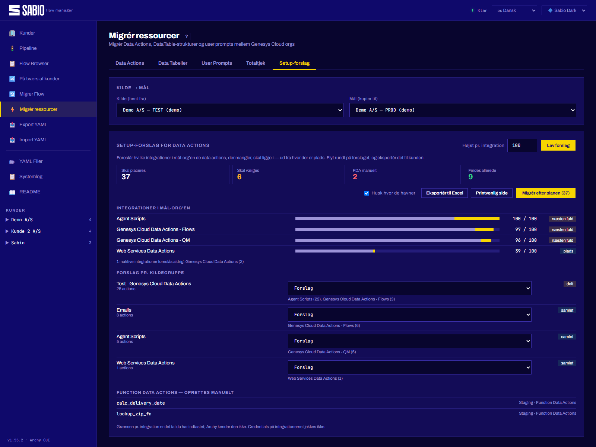

*Eksempel med opdigtede data (Demo A/S — TEST til PROD): billedet viser appens rigtige brugerflade, men svarene er beregnet af appens egne funktioner på en opdigtet org, ikke hentet fra en kunde. Faneblade kræver to forskellige orgs.*

**Fanen Wrap-up-koder** migrerer koder med navn og division (kræver `routing:wrapupCode:view/add`). Findes navnet i målet, springes koden over; findes divisionen ikke, bruges standarddivisionen.

**Fanerne OAuth-klienter og Integrationer** flytter en hel opsætning til en ny org. Brug rækkefølgen **Roller → OAuth-klienter → Integrationer → Data Actions**.

- *Roller* kopierer brugerdefinerede roller med deres rettigheder (standardrollerne findes i alle orgs). Rettigheder med en betingelse på bestemte divisioner eller køer springes over og meldes i loggen, så rollen ikke bliver stærkere end i kilden. Kræver `authorization:role:view/add`.

- *OAuth-klienter* kopierer navn, grant type, redirect-URI'er, scope og roller. Roller og divisioner matches på **navn** — brugerdefinerede roller skal altså findes i målet først (brug fanen *Roller*); det der ikke kan matches, meldes i loggen. Genesys kan ikke udlevere en klients secret, så hver ny klient får en **ny secret**, som vises kun én gang; **💾 Download secrets** gemmer dem som JSON. Gem filen sikkert og slet den bagefter. Mangler klienternes divisioner eller roller i målet, spørger programmet om de skal oprettes først. Bruges divisioner ikke i målet, kan du i stedet vælge at give rollerne i Home-divisionen. Rækkefølgen er: log ind, giv dig selv de migrerede roller i målet (fx *Sabio Master Admin*), log ind igen, og migrér så klienterne. Den bruger der er logget ind, skal selv have rollerne i målet for at kunne give dem til en klient (Genesys svarer ellers *bad.client.role*). Findes en klient med samme navn i målet, springes den over. Kræver `oauth:client:view/add` og `authorization:role:view`.
- *Integrationer* opretter integrationen med samme type og konfiguration. Credentials kan ikke læses fra Genesys: en OAuth-klient migreret i samme omgang (uden at genstarte programmet) kobles automatisk på integrationens credential, mens alle andre credentials (API-nøgler, basic auth m.m.) står i loggen som manuelt arbejde. En integration aktiveres kun hvis kilden var aktiv og intet mangler. Kræver `integrations:integration:view/add/edit` og `integrations:credential:view/add`.

**Fanen User Prompts** migrerer user prompts mellem orgs. Både TTS-teksten og indtalt lyd kopieres — prompts med lyd er markeret 🔊 i listen.

**Fanen Scripts** migrerer scripts mellem orgs. Scriptet eksporteres fra kilden og importeres i sin helhed i målet, og er det publiceret i kilden, publiceres det også i målet — et flow peger på den publicerede udgave. Findes et script med samme navn i målet, springes det over. Scriptet lander i målets standarddivision.

**Fanen Data Tabeller** migrerer DataTable-*strukturer* mellem orgs: vælg kilde- og mål-org, markér tabellerne, klik **⚡ Migrér valgte**. Kun kolonnedefinitionen kopieres — **rækkerne følger ikke med**. Findes kildens division i mål-org'en, oprettes tabellen der; ellers havner den i standarddivisionen, og loggen siger det. **💾 Download backup** henter de valgte tabellers struktur som en JSON-fil uden at skrive noget i nogen org.

> **Function Data Actions kan ikke migreres.** Deres `requestUrlTemplate` er ikke en URL, men et ID på en function der ligger i kilde-org'en. Der er ikke noget API til at oprette functionen i mål-org'en, så den skal oprettes manuelt først.

Der kopieres navn, kategori, input/output-schema, request-config (URL, metode, headers) samt request- og success-templates. Templates hentes fra kilden og indsættes direkte i den nye action, så den ikke refererer tilbage til kilde-orgen.

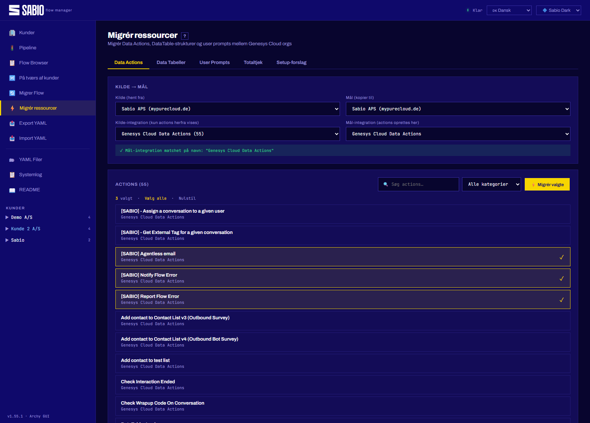

> **Kategorien følger mål-integrationen.** En migreret action oprettes med mål-integrationens navn som kategori — det er den et flow slår den op på — og ikke med kildens kategori. Kan navnet ikke læses, beholdes kildens. Loggen siger det, når kategorien ændres.
>
> **Bemærk:** Kategori-navne skal matche mellem orgs. Hvis kilden bruger `Genesys Cloud Data Actions - QM` men målet kun har `Genesys Cloud Data Actions`, skal du enten omdøbe integrationen i mål-org'en eller justere YAML'en før import.

#### 🧙 Flow Builder · Beta
> **Beta.** Flow Builder er stadig under udvikling. Tjek altid YAML'en med **🔍 Valider YAML** og **🌐 Tjek mod org** før du importerer.

Wizard til at bygge Archy YAML trin for trin uden at skrive YAML i hånden. Understøtter alle 16 flow-typer, Data Tables, Data Actions med schema-hentning, og transfer/disconnect-handling.

#### 🗂 YAML Filer
Alle flows værktøjet har eksporteret til disk. De havner her fra **Export YAML**, men også fra **migreringer** og **⇄ sammenligninger**, som begge eksporterer undervejs.

Archy navngiver filerne `<Flownavn>_v<major>-<minor>.yaml` — `Test33_v1-0.yaml` er altså flowet *Test33* i version *1.0*. Listen splitter det ad og viser flownavn, version, flowtype, kunde, tidspunkt og størrelse.

Filtrér på **kunde**, **flowtype** og fritekst. **Kun nyeste version** er slået til som standard, så ældre eksporter af samme flow foldes sammen — tælleren viser hvor mange der er skjult.

Hver fil kan åbnes (**View**) eller sendes videre til Import-siden (**Import**).

**🧹 Ryd op** fjerner gamle versioner: vælg hvor mange der skal beholdes pr. flow — 2 som standard, så du kan falde tilbage til en tidligere version — og godkend listen inden noget slettes. Filer uden versionsnummer røres ikke.

#### 📋 Systemlog
Alle handlinger logges i realtid. Filtrer på tidsrum, niveau, handling, kunde og fritekst. Tiden vises i maskinens egen tidszone (UTC står i tooltip); *15 min* og *1 time* går til og med nu, og *I dag* er fra midnat.

**SECURITY** viser prod-login, hvem der fik eller ikke fik deploy-ret og hvorfor, og hvert forsøg på at skrive til prod der blev afvist.

**Selve logteksten er altid engelsk**, uanset hvilket sprog brugerfladen står på. Kolonneoverskrifter og filtre følger sproget; linjerne gør ikke. Loggen bliver kopieret ind i en sag og læst af folk der ikke nødvendigvis kører programmet i samme sprog som den der lavede migreringen.

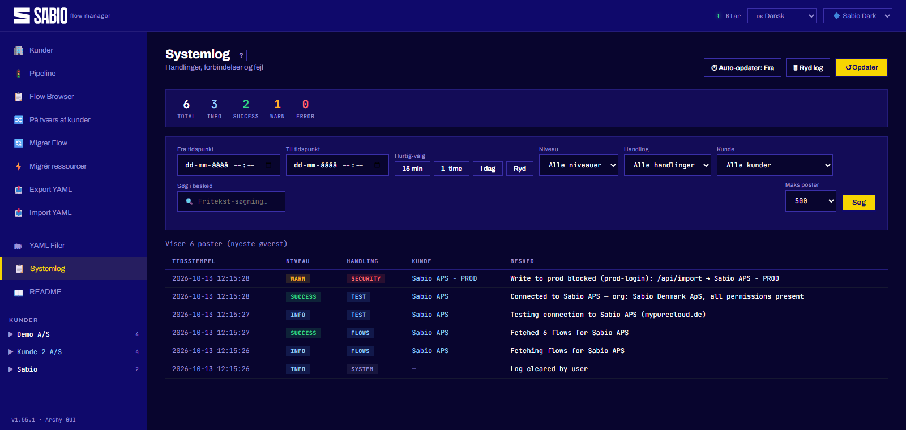

---

### Temaer og sprog

Begge vælges i topbaren og gemmes i browserens `localStorage`, så valget huskes til næste gang.

| Tema | Beskrivelse |
|---|---|
| 🌙 Archy Dark | Standard — mørk med orange accent |
| ☀️ Archy Light | Lys med orange accent |
| 🔷 Sabio Dark | Sabio-brand: navy `#0F096B` med gul `#F7D501` |
| 🔹 Sabio Light | Sabio-brand: off-white med lilla `#6518BB` |

Sabio-temaerne viser Sabios ordmærke i topbaren i stedet for "ArchyGUI" og bruger brandets skarpe hjørner.

Sprog: 🇩🇰 Dansk · 🇬🇧 English · 🇫🇷 Français · 🇳🇱 Nederlands · 🇪🇸 Español. Knapperne har tooltips på alle fem sprog, og hver side har en **?**-hjælp.
Tekniske betegnelser oversættes ikke — flow-typer (`InboundCall`, `Workflow` …), regionsnavne, logniveauer (`INFO`, `ERROR` …) og Genesys-kategorinavne vises som i API'et.

---

### Regioner

| Org | Region-værdi |
|-----|--------------|
| EU Frankfurt | `mypurecloud.de` |
| US East | `mypurecloud.com` |
| EU Ireland | `mypurecloud.ie` |
| AP Sydney | `mypurecloud.com.au` |
| AP Tokyo | `mypurecloud.jp` |
| US West | `usw2.pure.cloud` |
| EU London | `euw2.pure.cloud` |
| Canada | `cac1.pure.cloud` |

### Sikkerhed
- Client Secrets vises aldrig i GUI efter gemning, og maskeres i logfil og systemlog
- OAuth PKCE: ingen secret gemmes — token lever kun i serverens hukommelse
- **Et login gælder kun den org miljøet hører til.** Med trusted orgs vælger man selv org'en på Genesys' login-side, så værktøjet slår op hvilken org login'et landede i, før tokenet gemmes. Passer den ikke med miljøets kendte org — eller hører den til en anden kunde — kasseres tokenet. Login'et beder altid om et nyt login (`prompt=login`) og peger på miljøets org (`target`), så en husket session i en anden org ikke genbruges stille. Både API-kaldene og Archy tjekker org'en igen hver gang tokenet bruges, og et kendt org-id overskrives aldrig. Samme OAuth-klient betyder kun samme org ved client credentials
- **Skrivning til prod kræver et personligt login.** Et prod-miljø skal bruge OAuth (PKCE); med client credentials kan det læses, men ikke skrives til. Ved login slår værktøjet brugeren op i Genesys og tjekker rettigheden — som standard `architect:flow:publish` — og eventuelt medlemskab af en gruppe. Begge sættes pr. miljø under **⚙ Indstillinger**. Deploy-retten gælder 30 minutter efter login; derefter logger man ind igen. **Genstarter man programmet inden for de 30 minutter, huskes login'et** — så skal man ikke gennem MFA igen: tokenet gemmes i din egen brugermappe (`~/.archy-gui/session.json`), kun for friske logins og kun for de miljøer og den org, der blev logget ind til, og filen ryddes når de udløber. Sæt `rememberLoginMinutes` til `0` i `settings.json` for ikke at gemme noget. Archy og API-kaldene kører med brugerens eget token, så Genesys håndhæver også selv rettighederne, og audit-loggen viser personen. Kræver en OAuth-klient af typen *Code Authorization* i prod-org'en med redirect URI `http://localhost:3737/auth/callback`. Rettigheder pr. division (`architect:flow:publish:<division-id'er>`) tæller med
- Trin, godkendelse, Client ID, region og deploy-krav på et prod-miljø kan kun ændres med et gyldigt prod-login — ellers kunne man sætte trinnet til "uat", skrive, og sætte det tilbage. Undtagelsen er et nyt **Client ID alene** på et OAuth-miljø: login'et går gennem klienten, så en slettet eller forkert klient ellers aldrig kunne rettes. Org-id'et bliver stående, så den nye klients login skal lande i samme org, og skrivning kræver stadig et friskt prod-login. Redigering tager kun imod de felter der kan redigeres
- Serveren binder til `127.0.0.1`. Sæt `HOST` hvis den bevidst skal nås udefra — men der er ingen adgangskontrol foran, så det bør ikke gøres uden
- Filstier fra brugerfladen holdes inden for `flows/`, både ved læsning og skrivning
- Felterne på et miljø tjekkes når de gemmes: navnet må ikke indeholde `< > : " \ | ? * % ! ^ $ '` samt backtick og kontroltegn, ikke være et reserveret Windows-navn og ikke give samme eksportmappe som et andet miljø; præfikset må kun være `A-Z 0-9 _ -`; Client ID skal være et GUID og regionen en kendt. `/` er tilladt, så "A/S" kan bruges
- Navne fra en org escapes før de tegnes: `escapeHtml` i HTML-tekst, `jsAttr` i en `onclick`. Et flow der hedder `` vises som tekst
- Værdier på Archys kommandolinje citeres, og et flownavn med et anførselstegn afvises: Archy kaldes gennem `cmd.exe`, hvor tegnet ikke kan escapes

### Filer
```
Archy-gui/
├── server.js          # Express backend
├── start.bat          # Start server skjult i baggrunden + åbn browser
├── stop.bat           # Stop serveren
├── customers.json     # Kunder (auto-genereret)
├── settings.json      # Egen trinliste (oprettes når den gemmes)
├── server.log         # Server-output
├── flows/             # Lokale YAML-filer
│   └── <kundenavn>/
│       └── *.yaml
├── public/
│   └── index.html     # Frontend SPA
├── test/              # Enhedstests (npm test)
│   └── *.test.js
├── docs/              # Skærmbilleder og infografik til README
└── package.json
```

### Tests (for udviklere)

Du behøver **ikke** køre testene for at bruge programmet. De er til den der ændrer i koden: kør dem før du committer, så opdager du hvis en ændring har ødelagt noget der virkede.

```bash
npm test
```

420 enhedstests af de rene funktioner — navngivning ved forfremmelse, miljøpræfikser, gruppespærringen, omskrivning og sammenligning af YAML, fejltekster fra Archy og Genesys, og maskeringen af client secrets. Ingen af dem rører en Genesys-org, en fil eller Archy, så de kan køres når som helst.

Et par af dem holder øje med at **trin-rækkefølgen og versionsendelsen kun står ét sted** — de læser både `server.js` og `index.html` og fælder, hvis reglerne bliver skrevet af igen.

`test/sikkerhed.test.js` spærrer for tre huller der har været åbne: læsning uden for `flows/`, skrivning uden for `flows/`, og kommandoindsprøjtning gennem et flownavn. De er skrevet mod de angreb der faktisk virkede.

`test/log-engelsk.test.js` læser `server.js` og fælder hvis en dansk besked er sluppet ind i systemloggen — også ad bagvejen gennem en kastet fejl.

`test/escape.test.js` læser `index.html` og fælder hvis et navn fra en org går uescapet ind i HTML — og prøver `escapeHtml` og `jsAttr` af med navne der ville køre kode.

`test/prod-rettigheder.test.js` fælder hvis en ny rute der skriver til en org, ikke står bag prod-vagten. `test/syntaks.test.js` oversætter hvert script i `index.html`, så et enkelt forkert tegn ikke kan stoppe hele brugerfladen. `test/ui-sprog.test.js` og `test/tooltips.test.js` fanger dansk uden om oversættelserne og tooltips — også ⓘ ved felterne — der peger på tekster der ikke findes. `test/miljoer.test.js` og `test/fejl.test.js` afprøver at et login i en forkert org afvises, og at Archy aldrig får et token fra en anden org. `test/readme.test.js` holder versionen og antallet af tests her i takt med `package.json`, brugerfladen og `CHANGELOG.md`.

Testene ligger i `test/` og kræver ingen pakker ud over Node selv (`node --test`, Node 18+).

---

<a name="english"></a>
## 🇬🇧 English

A graphical interface for [Archy](https://help.mypurecloud.com/articles/archy/) with multi-customer support, flow migration, Data Action migration, and OAuth PKCE login.

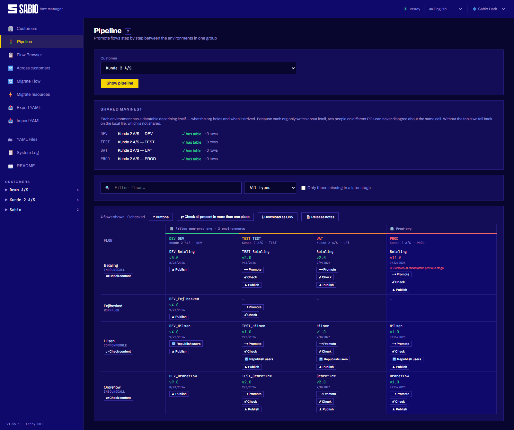

*Pipeline with Demo 2 — what you see when the app opens. The environments are columns in stage order, the flows are rows.*

> The current version and every change are in [CHANGELOG.md](CHANGELOG.md) — see the top of this page.

### Requirements
- **Node.js 22.23.4, 24.22.1, 26.12.1 or newer** — the versions with the security fixes from 21 October 2026 ([Node.js](https://nodejs.org/en/blog/vulnerability/october-2026-security-releases)). Older lines (18, 20, 25) get no fixes, and the app prints a warning at start if the version is too old
- **Archy** installed. Preferably in PATH (`archy version` must return a version); otherwise the app looks in `C:\Tools\Archy`, `C:\Archy`, `C:\Program Files\Archy` and your user folder, or you put the folder holding `archy.bat` in `archyDir` in `settings.json` (or set the environment variable `ARCHY_DIR`). Restart with `start.bat` afterwards
- **Windows** (`start.bat`/`stop.bat`) and a browser
- A Genesys Cloud OAuth client of type **Code Authorization** (PKCE) per org, with redirect URI `http://localhost:3737/auth/callback` — see [setup below](#setting-up-the-oauth-client-pkce). Older environments using Client Credentials still work, but new ones are always created with PKCE

#### Setting up the OAuth client (PKCE)

Done once per Genesys org (the **📋 Setup** guide in the app walks you through the same steps and checks them against the org):

1. In Genesys Cloud: **Admin → Integrations → OAuth → Add Client**.
2. **Grant Type:** *Code Authorization*. (*Client Credentials* is only used by older environments.)
3. **Authorized redirect URIs:** `http://localhost:3737/auth/callback` — exactly like this, no trailing slash. If the app runs on another port (`PORT`), the URI must follow it, and `OAUTH_REDIRECT_URI` in `server.js` must be changed to match.
4. **Scope:** a call must be allowed by **both** the user's roles and the client's scopes. Pick at least `architect`, `scripts`, `integrations`, `authorization`, `routing`, `users`, `groups` and `oauth` (the last four may be `:readonly`). A missing scope fails the call with *app.not.authorized.for.scope* — **🔌 Test** shows it as `scope …` next to the feature. A new scope only applies after a new login.
5. Save, and copy the **Client ID** (a GUID). There is no secret to store; PKCE uses none.
6. In the app: create the environment with **🌐 OAuth (PKCE)**, paste the Client ID, pick the region, and press **Log in**. Log in to the right org — a login in another org is rejected.

**Permissions for the user who logs in** (verify them with **🔌 Test**):

| Feature | Permissions |
|---|---|
| Read flows | `architect:flow:view`, `architect:ui:view` |
| Import flows | `architect:flow:add`, `architect:flow:edit` |
| Publish flows (and deploy to prod) | `architect:flow:publish` |
| Data tables and manifest | `architect:datatable:view/add`, `architect:datatableRow:view/add/edit` |
| Data Actions | `integrations:integration:view`, `integrations:action:view/add` |
| Prompts | `architect:userPrompt:view/add` |
| Scripts | `scripter:script:view/add`, `scripter:publishedScript:view/add` — and the `scripts` scope on the OAuth client |
| Divisions, queues, users | `authorization:division:view`, `routing:queue:view`, `directory:user:view` |
| Dependencies | `architect:dependencyTracking:view` |
| Show the OAuth client's name | `oauth:client:view` |

If a permission is missing, **🔌 Test** shows exactly which. A prod environment also requires the deploy right (default `architect:flow:publish`).

**Common errors:** *redirect_uri mismatch* → the URI in the client is not exactly the one above. *Wrong org* → you logged in to a different org than the environment's. *Port in use* → close the other instance with `stop.bat`.


### Installation

```bash
cd C:\Tools\Archy-gui
npm install
```

### Starting the app

Double-click **`start.bat`** or run `node server.js` manually. `start.bat` starts the server **hidden in the background** (output in `server.log`, errors in `server.err.log`), opens **http://localhost:3737** and closes its own window — the server keeps running. **`stop.bat`** stops it, and running `start.bat` again restarts it, e.g. after an update.

When groups are set up, **the app opens on Pipeline** with the customer you last worked on — as in the picture at the top. The board is fetched when you press *Show pipeline*.

---

### How it fits together

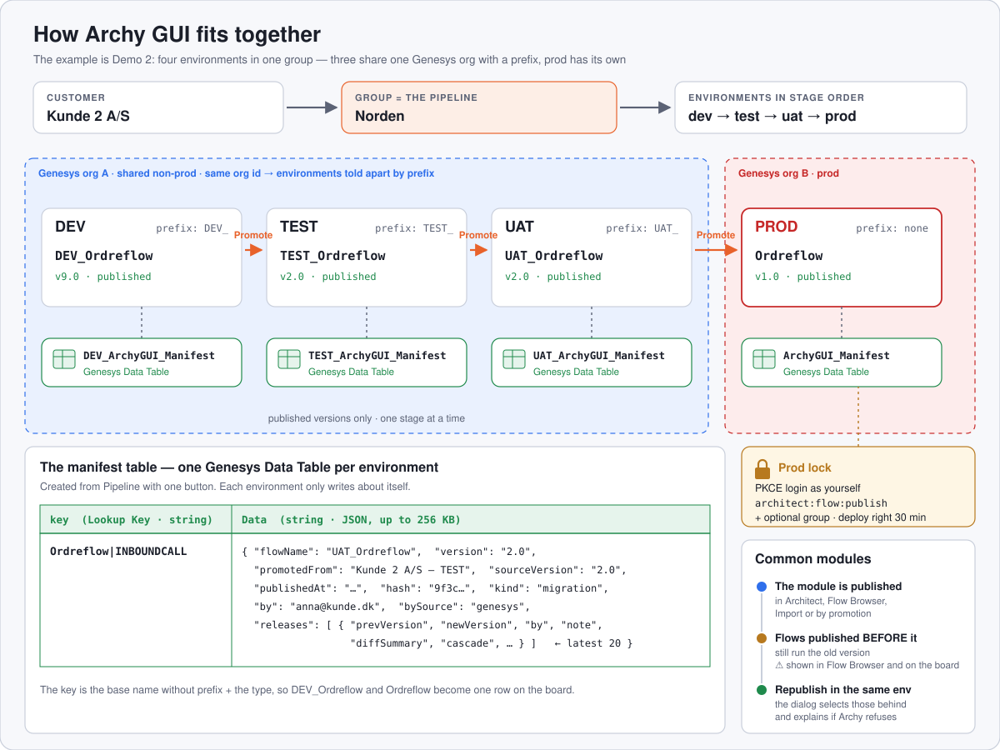

A **customer** has one or more **groups**, and each group is a **pipeline** of environments: dev → test → uat → prod. An environment is one Genesys org seen through one OAuth client. When several environments share an org, they are told apart by a **prefix** in the flow name. Flows are **promoted** one stage at a time, and each environment keeps its own history in a **manifest table** — a Genesys Data Table in the org. Prod is locked behind a personal login, and when a **common module** changes, the flows that use it are republished in the same environment.

### Features

#### 🏢 Customers
New environments are always created with **🌐 OAuth (PKCE)**: you log in to Genesys as yourself, only the Client ID is stored, and the token lives only in server memory. Older environments using **🔑 Client Credentials** (Client ID + secret in `customers.json`) still work and are marked in **yellow**.

**⚙ Settings** on each card holds name, customer, group, stage, prefix, org label, colour, division, authentication and prod requirements. Fields are checked on save (see Security), and renaming an environment moves its export folder along.

**Help on every field.** Every field — when creating an environment and under ⚙ Settings — has a label and an **ⓘ**. Hover ⓘ to see what the field is for, or click it to unfold the explanation below the label.

**Authentication and Client ID.** *Authentication* shows the environment's current choice — new environments always get OAuth (PKCE), and when an older one uses client credentials, a note says PKCE is recommended. The Client ID is filled in, and below it the **name of the OAuth client in Genesys** and its type are shown, so you can find it again among the customer's clients (requires a login and `oauth:client:view`). The secret field only appears for client credentials, and the deploy requirements only on prod.

**🔌 Test** checks the connection and the **permissions**. The app looks up the environment's actual permissions — directly for a person (PKCE), via the client's roles for client credentials — and holds them against each feature: reading, importing and publishing flows, Archy, data tables and manifest, Data Actions, prompts, divisions, queues, users and dependencies. The card shows a ✓/✗ list with the missing permissions. If the client's roles cannot be read (needs `oauth:client:view` and `authorization:role:view`), read access is tried instead, and what cannot be tried without writing is shown as *could not be verified*. If the connection fails, the error is shown on the card.

**📋 Setup guide.** The **📋 Setup** button on an environment card — and a link after a new environment is created — opens a checklist in its own window, to keep beside Genesys: create the OAuth client (grant type, PKCE), redirect URI, the environment's fields here, log in, permissions (the list of what the app uses), division, manifest table and — on prod — deploy rights. Items with **Check** are verified by the app against the org; **▶ Check all** runs them all. The rest you tick off, and the ticks are remembered per environment in the browser. **The guide runs *Check all* by itself when it opens**, and the card shows whether it has been gone through (`x of y`) — counting only the steps the app has verified against the org (or you have ticked); the org knowing the environment is not enough. So every PC that connects to the same customer sees the same, and an environment only counts as properly set up once permissions, client, division and manifest are checked. The last step, *Get flows into the environment*, is optional and does not count. The **📋 Setup** button is highlighted until the guide has been gone through. **If it has not, it is offered after you log in or test the connection** — with *Open the guide*, *Later* and *Do not show again for this environment*.

**🔎 Find what is already set up.** After login the guide looks for ArchyGUI's own tables in the org. If the environment was set up from another PC, it is there — with name, customer, group, stage and prefix — and **Use this** takes it into use without writing anything. **Create new from this** makes a new environment in the same org with that setup as a template; you choose stage and prefix, and prefixes already in use are refused. If the org has nothing, you choose between **Import/export only** and **Start a pipeline**. A card for an environment in the **same org** that this PC does not have yet — dev, say, when you start with prod — can be added with **Add as a new environment**: it becomes an extra PKCE environment with the setup from the org, and nothing is written to the org. The setup also lists the pipeline's environments in **other orgs** — prod, say — and they can be added from here in one click; the org id is set right away, so the login is refused if the wrong org is picked.

**Import/export only.** An environment without a stage is not part of any pipeline. It imports and exports flows like any other, but ArchyGUI creates no table and writes nothing in its org.

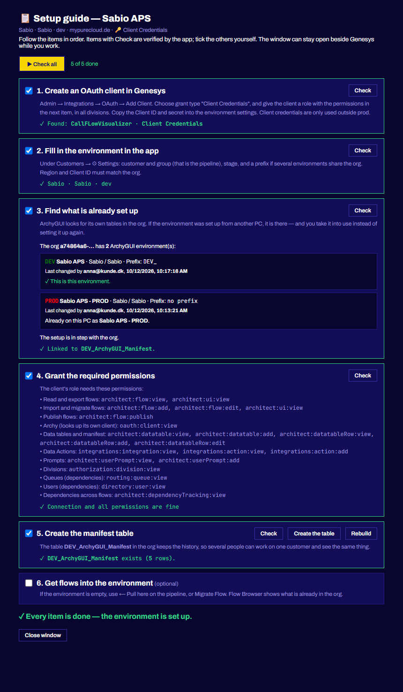

**Log in where you are.** When an environment needs a login, a bar with a **Log in** button appears at the top — on every page, not only Customers — and the page reloads afterwards. 🔒 next to the environment in the sidebar logs in too; 🟢 once logged in. Hover 🟢 — or look at the login badge on the card — to see which org you are logged into.

**Many customers.** The search box above the cards matches name, customer, group, stage and org label, and *Only those requiring login* shows the ones still missing. Cards are sorted by customer and stage, and the form and demo customers are collapsed.

**Customer → group → environment.** One record is one *environment*. Two levels above it decide what may be migrated between: the **group is the pipeline**, whether it is named after a country or a company. Each environment gets a stage from `dev → test → uat → prod`. With only one group, the picker is hidden.

**Custom stages.** Under **Customers → Stages** the list can be extended with e.g. `staging` or `preprod` and sorted with the arrows. The list applies to the whole app and is stored in `settings.json`. **Prod is always last**, since login, deploy rights and the write guard depend on it, and a stage used by an environment cannot be removed. Custom stages are yellow — orange when right before prod.

**Prefix: several environments in one org.** Some customers do not have one org per environment but **one org where environments are told apart by a prefix**:

| Environment | Prefix | Flow is named | Manifest table |
|---|---|---|---|
| dev | `DEV_` | `DEV_Ordreflow` | `DEV_ArchyGUI_Manifest` |
| test | `TEST_` | `TEST_Ordreflow` | `TEST_ArchyGUI_Manifest` |
| uat | `UAT_` | `UAT_Ordreflow` | `UAT_ArchyGUI_Manifest` |
| prod | *(empty)* | `Ordreflow` | `ArchyGUI_Manifest` |

Create one environment per prefix. The app looks up the **org id** in Genesys and so sees that they share an org — even when they use different OAuth clients, e.g. dev with client credentials and prod with PKCE. A PKCE environment gets its org id at its first login, and a known org id is never overwritten. Each environment only sees its own flows in Flow Browser, Export and on the board. Prod without a prefix takes everything that does **not** carry a sibling prefix — otherwise prod would see the whole org.

> **The prefix must match exactly.** A flow named `DEV Something` with a space instead of `DEV_Something` belongs to prod, not dev.

**Org label** is only a heading on the pipeline, so you can see which environments live in the same org.

**Colour.** Each environment shows in its stage colour — dev green, test yellow, uat orange, prod red — on the pipeline, in the sidebar and on the cards. Pick another under ⚙ Settings.

**Right org at login.** With trusted orgs you pick the org on Genesys' login page. The login checks which org it landed in and is refused if it doesn't match the environment's — or belongs to another customer. The org is shown next to the environment once logged in.

**Demo customers.** Two buttons create a complete setup that exists only locally — no credentials, no calls to Genesys or Archy:

| Demo | Setup |
|---|---|
| **Demo 1** | four orgs, one environment each |
| **Demo 2** | `DEV_`, `TEST_`, `UAT_` share one org; prod has its own and no prefix |

Both can exist at once. `↺ Reset` puts them back, `✕ Remove` deletes environments, flows and manifest rows.

#### 📋 Flow Browser
Fetch, search and filter the environment's flows. Filter by **flow type** (the list is populated from the types the environment actually has, with a count each) and by free text. Click **Export** directly from the list.

**⚠ Common modules newer than their flows.** Every time the list is fetched, the tool checks whether a common module was published *after* a flow that uses it — the flow then still runs the old version. This is shown in a yellow box per module with a **🔁 Republish them** button, and the rows are marked ⚠. Published common modules also get a **🔁 Users** button (see [Common modules](#-common-modules-1)).

**🚀 Publish.** Flows migrated with the `create` action sit as a checked-in draft without being live. They get a **Publish** button that publishes the version already in the org — without fetching anything from the source again. For a common module you are then offered to republish the flows that use it. Flows checked out by a user read **Checked out** in the version column.

**⇄ Compare two orgs.** Pick an org under *Compare against org* and each row gets a ⇄ button. It exports the flow from both orgs and compares the **content** — not the version numbers, which are per-org counters and say nothing about what the flow contains.

| Verdict | Meaning |
|---|---|
| ✓ Identical content | The same flow, regardless of it being e.g. v37 and v1 |
| ⚠ N differences | The first ones are shown line by line |
| ⚠ Does not exist in the target org | The flow is missing entirely |

The dialog also shows when each side was last **published** and by whom, and — if the flow was migrated with this tool — which org and which source version the target was built from.

**📌 Set baseline.** Records how the comparison org's flows look right now. From then on the tool can catch someone publishing directly in the target org, **including for flows it never migrated itself**. Run it once per pair of orgs you work with — e.g. `dev → uat` and `dev → prod` for each customer.

> The records live in `flows/.migrations.json`, keyed on the Genesys org id. **The file is machine-specific and is not shared** — if several of you work on the same customer, create the shared manifest in the org instead (see [Pipeline](#-pipeline-1)).

#### 🚦 Pipeline
When groups are set up, **the app starts here**, with the customer you last worked on selected. The board is only fetched when you press *Show pipeline* — it calls every org in the group.

Pick a customer and group and get the group's environments as columns in stage order, with flows as rows. Environments living in the **same org** are gathered under that org's name. Each column carries the environment's colour in its heading (see Colour under Customers); the cells themselves are not coloured, since red already means something is wrong.

Each cell shows the flow's **name in that environment**, its published version and when. Version numbers **cannot** be compared across orgs — they are per-org counters — so they are for orientation only.

| Colour / marker | Meaning |
|---|---|
| green | published, with nothing suggesting it arrived out of band |
| ✗ **published outside the pipeline** | the manifest says we left the environment at v*N* and it stands higher. Applies only where the environment *received* the flow — working in dev is not going around anything |
| ✗ **N versions ahead of the previous stage** | published more times than the stage feeding it. An indication, not proof |
| ⚠ **N versions not promoted** | work continued without being pushed onward |
| ⚠ **only exists in a later stage** | built outside the chain |
| ? **unknown** | the org could not be read — we do not know what is in it |

**Promotion** moves one stage at a time and lands on *Migrate Flow* with source, target and flow filled in, so dependency checks and division choices work as usual. Only a **published** version can be promoted — a draft has not been tested. Prod requires your prod login (see Security).

**Every button says what it does before it does it.** ⟶ Promote, ⟵ Pull here, ⟵ Pull back, ↩ and ▲ Publish (demo) open a dialog with the flow, source and target, what happens step by step, and what to watch out for: the target is prod, the target was published outside the pipeline or is versions ahead — so those changes are lost — or ⇄ Check content found a difference. You choose to go ahead or **Cancel**. **? Buttons** in the board toolbar explains every button.

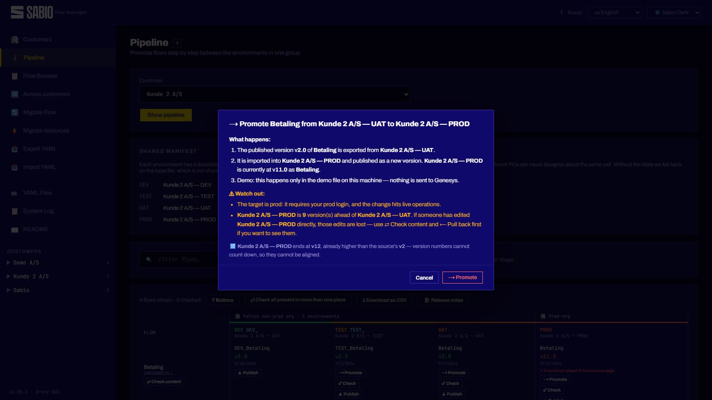

*⟶ Promote to a prod that is 9 versions ahead: the dialog says what happens, warns that edits in prod are lost, and that the version cannot be aligned.*

**Version alignment.** Each publish creates one new version, and the counter is per org — so after a promotion the target is usually lower than the source (dev v10 → test v3). The ⟶ Promote and ⟵ Bring here dialogs work out where the target will end up and offer to **align** (for *Bring here* it is switched on from the start, so a flow brought down into dev does not start at v1.0 when it is v5.0 in prod): the target is published the missing number of extra times, with the same content, so it matches the source number. The same choice is on *Migrate Flow* as *Align version number with the source* when the action is publish. If the target is already higher — like a prod that ran ahead — it cannot count down, and the dialog says so. At most 25 extra publishes per flow.

**Common modules are checked on the board too.** Once it is fetched, every environment in the group is checked: the top reads e.g. *⚠ Sabio APS - PROD: 2 common module(s) newer than 1 flow(s) that use them*, the module's cell is marked *⚠ N flow(s) not republished* with a yellow 🔁, and the flow's cell *⚠ older than …*. An environment that cannot be checked — prod without a login, say — is named.

**The name carries its history.** On promotion the flow gets the source's version stamped on it — `Ordreflow` → `Ordreflow_v10` — in **both** source and target. Keep working in dev and publish, and the name stays at `_v10` until the next promotion. The names alone then show which stage is behind.

The number is only set when the flow leaves **the group's first stage**. Onward from test, uat and prod the name travels as it is — `DEV_Betaling_v6` becomes `TEST_Betaling_v6`, `UAT_Betaling_v6` and `Betaling_v6`, however many times each environment has published on its own. **Common modules and bot flows never get a suffix**: other flows call them by name, and a new name would break every call.

**UAT without a prefix.** An environment may have no prefix in an org it shares with prefixed siblings — e.g. `DEV_` and `TEST_` in one org, UAT unprefixed beside them, and prod in another org. The flow then has the same name in UAT and prod. UAT takes everything in the org that does not carry a sibling's prefix. Only **one** environment per org can be unprefixed; the server rejects a second.

**Changing an environment's prefix** shows a plan before saving: which **flows**, **data tables** and which **manifest table** get a new name, e.g. `UAT_Betaling` → `Betaling`. Untick what should stay, and press *Rename and save*. Names are changed through the Genesys API — not through Archy, which finds flows by name and would create a new one beside it — so flows keep their id, every version gets the new name, and whatever points to them keeps working. A name that already exists is skipped. If one rename fails, the others are rolled back and the prefix is not changed. Common modules and bots are marked: they are called by name in exported YAML, so saved files and other tools must be fixed by hand.

**The way back.** If the flow exists only later in the chain — everything sitting in prod, say, when dev has just been set up — the cell gets a **⟵ Bring here** button that fetches it from the nearest later stage. If the environment has a prefix, the flow gets it on the way: `Bank bot` from prod becomes `DEV_Bank bot`. Datatables are handled the same way.

**⚙ FDA** and **✗ FDA missing here** show Function Data Actions on the board, so you see them before promoting. A flow that uses a Function Data Action gets a yellow *⚙ FDA* with the names as a tooltip. If the flow in the environment to the left uses one that does not exist in this environment, a red *✗ FDA missing here* appears — and the promotion is blocked until it has been created in Genesys. The information comes in the background from Genesys' dependency tracking, one lookup per Function Data Action, and the board is redrawn when it is there. The tracking only knows the **published** version and can lag a few minutes after a publish. A flow that uses an FDA only through a common module does not get the marker — the module does.

**✔ Check** sits next to ⟶ Promote and runs the first phase of a promotion — exports the flow from the source and examines everything it references in the target — but imports nothing and writes nothing in the target org. The answer is a report in three groups: what **blocks** the promotion (a Function Data Action that does not exist in the target, or a data action that exists in neither the source nor the target), what **must be decided** (a data action that exists under another category in the target — chosen at promotion or in the Full check), and what is **handled along the way or by hand** (tables and actions that can be migrated along, queues and other things to create in the target). The check uses the same examination as the promotion, so the two are never in disagreement; the blockers are the same ones that stop the promotion itself. The check is not a requirement: you can promote without having run it. It does not work on demo environments.

**⇄ Check content** exports the flow from each environment and compares the hash — the only thing that can decide whether two environments are the same. If they differ, a **⟵ Pull back** button appears going the other way, so you can bring reality down and see what was done.

#### 📝 Release notes and rollback
Every promotion writes a **release** holding what the target contained before and after, who did it, and which references were rewritten. The board cell gets a **📝 N** link to the flow's history in that environment, and the toolbar a **📝 Release notes** button for the whole group.

- **The diff** shows the lines that actually changed — trackingIds and other export noise are cleaned out. A note (e.g. a ticket number) can be added to each release.
- **Copy markdown / Download .md** gives notes ready for a change request or an email — one release or all selected.
- **↩ Roll back** publishes the content from before the latest promotion again, as a new version. The next click goes one promotion further back (`_v6` → `_v5` → `_v4`). Prod requires confirmation, as a promotion does. In the demo the name goes back too; in a real org the flow keeps its name, because a different name in the YAML would make Archy create a new flow beside it.

**Where it is kept.** The history lives in **the org**, in the environment's manifest table (`ArchyGUI_Manifest`), in the flow's row: the latest 20 releases with the version before and after, who, when and the note. The *content* is not stored there — Genesys already keeps every published version, so a rollback simply exports the version the target was on before, straight from the org. You can therefore promote from one PC and roll back from another.

The local `flows/.releases.json` (and the content in `flows/.releases/`) is a **cache**: it has the diff ready, sparing an export. When it is missing — because the release was made from another PC — the diff is built from the two versions in the org the first time it is expanded. An environment with **no manifest table** keeps its history only on the PC that made the release, and the list marks it *this PC only*.

To know the "before", the target's published version is exported ahead of the import — one extra Archy export per promotion.

#### 🔁 Common modules
A common module only takes effect in the flows that call it **once they are published again**. When a module is promoted (with the *publish* action), the tool finds the flows in the target environment that use it — through Genesys dependency tracking, including through another module — and offers to republish them. The published version is republished, never a draft; a flow with an unpublished draft is unticked by default, as the draft would be replaced. The module's release note records the list.

The same offer comes when a module is **published in Flow Browser**, **imported with publish** or **migrated**. **🔁 Republish users** on the board and **🔁 Users** in Flow Browser do the same for when the module was changed directly in Architect — and both places show it by themselves when a module is newer than the flows using it. The dialog preselects the flows running an older version; those already published after the module are listed but not selected.

**When a republish fails.** Republishing takes the published version and publishes it again — and the flow is then checked against the org as it is today. The dialog stays open with one line per flow: what is wrong and what to do about it — a TTS voice the org lacks, no default voice for a language, a queue, user, table, data action, prompt, schedule or flow that no longer exists (and where in the flow), an empty required field, or a locked flow. Archy's raw text and the path to its debug log are under *Details from Archy*.

**Filters.** Free text on the flow name, **flow type** (the list is built from the types the group actually has, with counts), and *Only those missing in a later stage*. They combine.

**⭳ Download as CSV** takes exactly the rows shown — including after a type filter — semicolon separated with a UTF-8 BOM so Danish Excel opens it in columns.

**Guards, enforced on the server:** migrating across groups is blocked; prod requires a deliberate confirmation **and a personal login with the permission** (see Security); the source must be published; source and target cannot be the same environment.

**Shared manifest.** Each environment can have a **Genesys Data Table** in its org — the same kind of table you see under *Architect → Data Tables* — named `ArchyGUI_Manifest`, prefixed if the environment has a prefix. It describes **itself**: what the org holds, when it arrived, and who did it. Because each org only writes about itself, two people on different PCs can never disagree about the same cell. The table is created with the button under *Shared manifest* on Pipeline or from the setup guide, never on its own, and needs the permission `architect:datatable:add`. Without it the tool falls back on a local file that is not shared.

The table has two columns:

| Column | Type | Content |
|---|---|---|
| `key` | string (Lookup Key), up to 256 characters | The flow's **base name without prefix** and its type: `Ordreflow\|INBOUNDCALL` |
| `Data` | string, up to 256 KB | JSON with what the environment holds and its history |

One row per flow. `Data` for `UAT_Ordreflow` looks like this:

```json
{
  "flowName": "UAT_Ordreflow",
  "version": "2.0",
  "publishedAt": "2026-09-08T10:12:00Z",
  "promotedFrom": "Kunde 2 A/S — TEST",
  "promotedAt": "2026-09-08T10:12:00Z",
  "sourceVersion": "2.0",
  "hash": "9f3c…",
  "kind": "migration",
  "by": "anna@kunde.dk",
  "bySource": "genesys",
  "at": 1788516720000,
  "releases": [
    { "id": "…", "at": 1788516720000, "kind": "migration", "sourceName": "Kunde 2 A/S — TEST",
      "prevVersion": "1.0", "newVersion": "2.0", "by": "anna@kunde.dk", "note": "CHG-1234",
      "diffSummary": { "added": 4, "removed": 1 }, "cascade": [], "rolledBackBy": null }
  ]
}
```

`by` is the Genesys user when the environment is logged in with PKCE (`bySource: "genesys"`), otherwise the PC user (`"machine"`). `releases` holds the latest 20 promotions, republishes and rollbacks — they are what **📝** and **↩** build on. Do not edit the rows by hand; the tool writes them.

> **One manifest per environment, not per org.** If several virtual environments share one org, each needs its own table: `DEV_ArchyGUI_Manifest`, `TEST_ArchyGUI_Manifest`, and `ArchyGUI_Manifest` for prod.
>
> The row key is the **base name without prefix** — `WeekNumber|INBOUNDCALL` — so the board can pair `DEV_WeekNumber` and `WeekNumber` as one row. In a single shared table the two environments would therefore write to the same key and overwrite each other, and both cells would show the same thing.

**The setup row.** Besides one row per flow, the table has one row keyed `ArchyGUI_Setup` describing the environment itself: name, customer, group, stage, prefix, colour, division, deploy requirements, region, org id, a fixed `pipelineId`, the customer's stage list, the prefixes the org uses, and the pipeline's other environments — including those in other orgs. That row is how a new PC finds the environments. It holds **no secrets**: no secret, no token, and a Client ID only for PKCE clients. It is written automatically when the table is created, when an environment in the pipeline is created, changed or deleted, and the first time an older environment writes to its manifest — in every org of the pipeline, but in prod only with a login allowed to deploy; otherwise it waits, and the card shows *⚠ The setup is not written to the org*.

**The org wins.** At login, 🔌 Test and when Pipeline opens, the org's setup is read in, and what changed is shown once at the top of the page. A change made on this PC is therefore written to the org straight away. If someone changed the org's row while a change from here was waiting, you choose in the guide who is right. **The prod guard is never loosened from outside:** the org cannot move a prod environment to another stage or change its deploy requirements — that becomes a disagreement, and taking the org's version needs a prod login. Stages the org has and the PC lacks (e.g. staging) are added to the list; none are ever removed. An environment without a prefix never takes flows carrying a prefix the org uses — not even on a PC where dev and test have not been added.

**The board keeps up.** While Pipeline is open, the app asks once a minute for a fingerprint of the manifest tables in the group shown, and if it changes — say a colleague on another PC promoted a flow — the board redraws by itself. The same happens when you return to Pipeline after a migration. The interval is set with `pipelineRefreshSeconds` in `settings.json` (at least 15; `0` turns it off). **From the board to Migrate** (*Bring here*, *Promote*) only the chosen flow is shown; to migrate more, turn *Show selected only* off.

**Rebuild.** If an environment's table is missing, a yellow warning right above the board on Pipeline says so — with a **Rebuild** button. If the table was deleted, **Rebuild** (under *Shared manifest* and in the guide) creates it again and writes the setup and one row per flow in the environment. Rows that exist are left alone. What the org holds now can always be read from Genesys; the history — who promoted what from where — is taken from this PC's local files where it exists. Rows without history are a baseline, and the result says how many got history.

#### 🔀 Across customers
Lists the flows that exist at **more than one customer** — for example the same common module in dev, uat and prod. Each customer is shown with its version, publish time and whether the flow is active.

The overview is one API call per customer and therefore fast. **⇄ Compare content** on a row exports the flow from each customer and compares the content hash — that takes time, so it only runs for the row you ask for.

> Both levels are needed: two customers can show the same version number and still hold different content, because the numbers are counted per org.

#### 🔄 Migrate Flow
Select source, target and flows. **Import action** and **🚀 Run Migration** sit above the flow list, so they can be reached without scrolling past hundreds of flows. Migration runs in two phases:

1. **Check** — the flow is exported from the source and the target org is inspected for everything the flow references. Nothing is written to the target in this phase.
2. **Import** — the flow is imported only after your decision.

If anything is missing, a dialog opens with two sections:

| Section | Contents | Action |
|---|---|---|
| Can be migrated now | DataTables, Data Actions, **common modules**, bot flows, transfer targets, **user prompts**, **scripts** | Checkboxes — migrated before the flow |
| Needs a decision | **Division** (create / use Home / skip), **survey form** (copy / skip), **TTS engine** the target lacks (replace with the target's TTS / skip) | Dropdown per resource |
| Must be created manually | Queues, **users** (a fixed user in *Transfer to User*), skills, wrap-up codes, schedules, knowledge bases, Function Data Actions | Create them in the target org first |

**The division the flow is created in** is checked before anything is imported. If the login may not create flows there, the flow stops with a message naming the division — give the role access in the division, or set a division on the target environment. A common module in a division that does not exist in the target goes into the target environment's division (Home if none is set).

**TTS engines** the flow speaks with (e.g. *Microsoft Azure*) that the target lacks are shown in the dialog with the languages they are used for. Choose *Replace with the target's TTS* and each language switches to a voice in the same language on an engine the target has — Genesys' own is preferred — both in the flow and in the modules migrated along. Languages the target has no voice for are shown as *No voice in the target*; the replacement cannot handle them, and they need a voice in the target first.

**Empty shells from a failed import.** Archy creates the flow before the content goes in. If the import fails, an empty flow is left in the target (version 1.0 with only *Disconnect*), never published. A common module, bot flow or transfer target therefore only counts as existing when it is **published** — so an empty shell is migrated again instead of being skipped.

**If the target cannot be read** — say the OAuth client lacks a scope — the resource is shown as *could not be checked* with the error below it, and it is not offered for migration.

Common modules are migrated with the same machinery as flows, and their **own** dependencies are handled first — recursively, bottom-up. A module that itself uses fifteen tables brings all of them along — and the same goes for its data actions (*secure* data actions included), user prompts and scripts.

> **Function Data Actions block.** If the flow uses a Function Data Action that exists in the source but not in the target, it cannot be created from here and the promotion is **stopped**: the dialog shows it in red with a **checklist to copy**, and the *Continue anyway* and *Migrate selected* buttons are hidden. Create it in Genesys in the target org and press **Check again**; only once it exists can the flow be promoted. The block is also in the import itself, so it cannot be skipped. This keeps the version number and the check in step, instead of fixing things afterwards directly in Genesys.

> **Data actions get the target's names.** A flow points at a data action by **category** (the integration's name) and **name**. If they are named differently in the target org — say *Test - Genesys Cloud Data Actions* in test and *Genesys Cloud Data Actions - Flows* in prod — the import fails even though the name exists. Archy therefore looks up both in the target, and if either is not an exact match, a list of the flow's data actions opens: *same* (exists), *saved*, *choose* (same name under another category — pick which) and *not found* (point it at an existing one, or let it be migrated in the next step). The reference in the flow is rewritten in the side copy that is imported; the source's own copy is never touched. Choices are saved per org pair — in the target org's manifest table if it has one, otherwise in `.data-action-map.json` — and only after a successful import, so they are applied automatically next time. To keep them from being saved, untick *Remember my choices*. A saved choice cannot be removed from the UI yet.

You can choose **Migrate selected and continue**, **Continue anyway** (the flow is imported even though something is missing — it will usually fail in Architect afterwards) or **Skip this flow**.

> **Dynamically resolved skills cannot be checked.** When a flow uses `FindSkill(Task.Skills)` the skill is decided at runtime. The dialog says so, but you have to verify yourself that the skills exist in the target org. The same goes for a user or queue given as an expression (`targetUser: exp: Task.user`) — if it does not exist, the call takes the flow's failure path rather than failing the import.

Everything missing is also written to the **System Log**, so you can find it again afterwards.

> **When Archy fails without saying why.** Some failures end as `Architect Scripting session ended in error ( code: 99 )` — Archy's generic terminator, which explains nothing. The message therefore carries the path to Archy's own full output:
>
> ```
> Architect Scripting session ended in error ( code: 99 )
>   — full Archy output: C:\Tools\Archy\archyHome\debug\archy-debug-….txt
> ```
>
> That file holds the whole run. Archy writes one per call.

#### 📤 Export YAML
Export a single flow or the whole environment with a live progress indicator. The environment's flows are listed as soon as it is chosen; type to filter. `*` shows all, and a star inside the text is a wildcard — `DEV_*log` finds `DEV_Create Logitems`. When several environments share an org, only this environment's own are exported.

#### 📥 Import YAML
- Paste YAML, upload a `.yaml` file, or drag-and-drop
- **🔍 Validate YAML** — browser-side syntax check (no API call)
- **🌐 Check against org** — verifies that all resources referenced in the YAML (division, queues, DataTables, Data Actions, Prompts) exist in the target org *before* importing
- When you publish a **common module**, you are then offered to republish the flows that use it. Importing to prod requires your prod login

#### ⚡ Migrate resources
This page migrates everything that is not a flow between two orgs, across eight tabs: **Data Actions**, **Data Tables**, **Wrap-up codes**, **Roles**, **OAuth clients**, **Integrations**, **User Prompts** and **Scripts**. Source and target org are chosen once and shared by all of them.

**The Data Actions tab:**
1. Select **source org** and **target org**
2. Select the **source integration** → only its actions are listed
3. The **target integration** is suggested automatically — check the note above the list
4. Select the actions to copy → click **⚡ Migrate selected**
5. The log shows per action: ✓ Created and published / ⚠ Already exists / ✗ Error, and ends with a summary

> **Why pick an integration?** Data Actions belong to an integration, and an org can have several of the same type — for example multiple OAuth integrations that group actions and spread the load. Picking one at a time preserves that grouping in the target org. The selection is cleared when you switch integration, so you cannot accidentally migrate across groups.
>
> The target integration is matched by name, or by integration type when only one candidate exists. If several are possible you must choose yourself — and migration is blocked until you do.

**The Full check tab** sets every data action in the source against the target org, by category and name, so the names can be sorted out before flows are migrated. A click on a number filters the list: *match*, *saved choice*, *to choose* (same name under another category), *missing* and *FDA missing* (a Function Data Action cannot be created from here). On each row you can point it at the action in the target it should use — *Use suggestions* takes every row with exactly one candidate — and **Save mapping** saves it, or removes a saved choice, for the whole org pair. It is the same mapping the list in the flow uses. **Check contracts** fetches the input and output schema from both sides for those that match and shows fields that are missing, extra or have another type or requirement — an action can have the same name and still not fit the flow; it takes 20 pairs at a time, so a large org can take a moment. If the two environments are in the same org there is nothing to compare, and the tab says so. Genesys' own built-in actions (the id starts with `static_`) are left out when they are missing in the target — they can be neither created nor migrated. Actions that are missing are still migrated on the Data Actions tab.


*Example with invented data (Demo A/S — TEST to PROD): the image shows the app's real UI, but the answers are computed by the app's own functions on an invented org, not fetched from a customer. These tabs need two different orgs.*

**The Setup proposal tab** proposes which integrations in the target org the missing data actions should live in. It is for the case where the source has few integrations and the target many — and an integration holds only a certain number of actions. You enter the limit per integration (Archy does not know it; the number is remembered in the browser), and the proposal puts the actions that are missing entirely and can be created from here into the **active** integrations of the same type that have room. A source integration's actions are kept together if there is room — preferably in an integration with the same name — otherwise they are split. Inactive integrations are never proposed, and if there is no active integration of the type, the proposal says what it should be called. The capacity bars show what is there and what is coming; a group can be moved to another integration and the bars follow. Function Data Actions and actions under another category are not included, but are counted and shown as *FDA by hand* and *To choose*. The proposal can be exported to **Excel** (CSV) or a **printable page** (Ctrl+P gives PDF) for the talk with the customer; it contains only names and numbers. **Migrate by the plan** creates the actions the proposal has placed, in the proposed integrations — one at a time, with the target integration chosen for each. You confirm first (with the count and any integrations over the limit), can stop along the way, and the log shows every action. If the target is prod, you are asked as for a promotion, and a prod login is required. What could not be placed is skipped. Afterwards where the actions ended up is remembered (*Remember where they end up*, on from the start): flows point at the source's category and name, so the mapping lets the list in the flow find them in the new integration without choosing again. The proposal is then counted again. The tab does not check credentials.

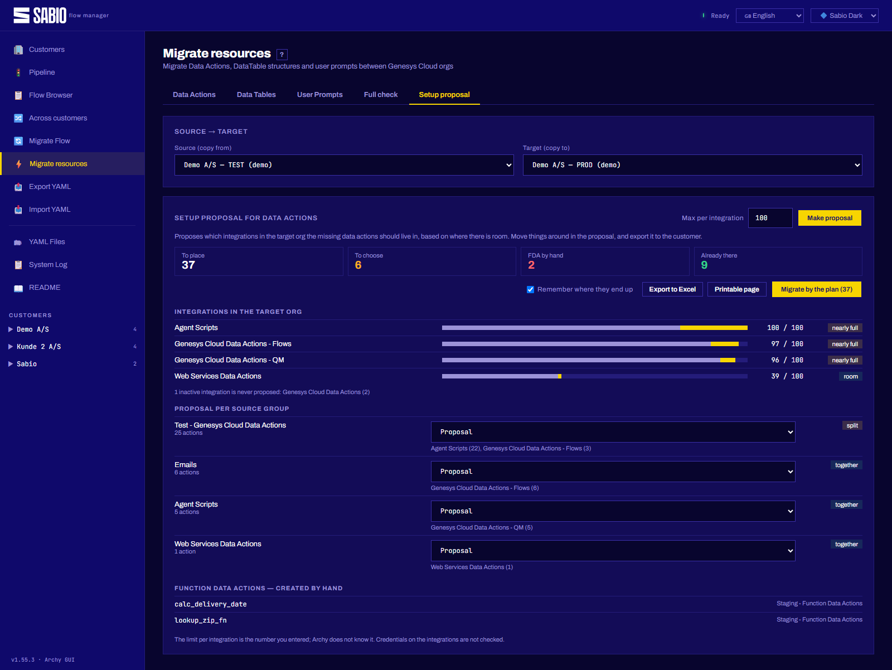

*Example with invented data (Demo A/S — TEST to PROD): the image shows the app's real UI, but the answers are computed by the app's own functions on an invented org, not fetched from a customer. These tabs need two different orgs.*

**The Wrap-up codes tab** migrates codes with name and division (needs `routing:wrapupCode:view/add`). If the name already exists in the target the code is skipped; if the division is missing, the default division is used.

**The OAuth clients and Integrations tabs** move a whole setup to a new org. Use the order **Roles → OAuth clients → Integrations → Data Actions**.

- *Roles* copies custom roles with their permissions (default roles exist in every org). Permissions with a condition on specific divisions or queues are skipped and reported in the log, so the role never becomes stronger than in the source. Needs `authorization:role:view/add`.

- *OAuth clients* copies name, grant type, redirect URIs, scope and roles. Roles and divisions are matched by **name** — custom roles must therefore exist in the target first (use the *Roles* tab); whatever cannot be matched is reported in the log. Genesys cannot hand out a client's secret, so every new client gets a **new secret**, shown only once; **💾 Download secrets** saves them as JSON. Store the file safely and delete it afterwards. If the clients' divisions or roles are missing in the target, the app asks whether to create them first. If the target does not use divisions, you can instead choose to give the roles in the Home division. The order is: log in, give yourself the migrated roles in the target (e.g. *Sabio Master Admin*), log in again, and then migrate the clients. The logged-in user must hold the roles in the target to give them to a client (otherwise Genesys answers *bad.client.role*). A client with the same name in the target is skipped. Needs `oauth:client:view/add` and `authorization:role:view`.
- *Integrations* creates the integration with the same type and configuration. Credentials cannot be read from Genesys: an OAuth client migrated in the same session (without restarting the app) is wired up to the integration's credential automatically, while all other credentials (API keys, basic auth etc.) are listed in the log as manual work. An integration is only activated if the source was active and nothing is missing. Needs `integrations:integration:view/add/edit` and `integrations:credential:view/add`.

**The User Prompts tab** migrates user prompts between orgs. Both the TTS text and any recorded audio are copied — prompts with audio are marked 🔊 in the list.

**The Scripts tab** migrates scripts between orgs. The script is exported from the source and imported whole into the target, and if it is published in the source it is published in the target too — a flow points at the published version. A script with the same name in the target is skipped. The script lands in the target's default division.

**The Data Tables tab** migrates DataTable *structures* between orgs: pick source and target org, select the tables, click **⚡ Migrate selected**. Only the column definition is copied — **rows do not come along**. If the source division exists in the target org the table is created there; otherwise it lands in the default division and the log says so. **💾 Download backup** saves the selected tables' structure as a JSON file without writing anything to any org.

> **Function Data Actions cannot be migrated.** Their `requestUrlTemplate` is not a URL but the id of a function living in the source org. There is no API to create that function in the target org, so it has to be created manually first.

Name, category, input/output schema, request config (URL, method, headers) and the request/success templates are copied. Templates are fetched from the source and inlined into the new action, so it never references the source org.

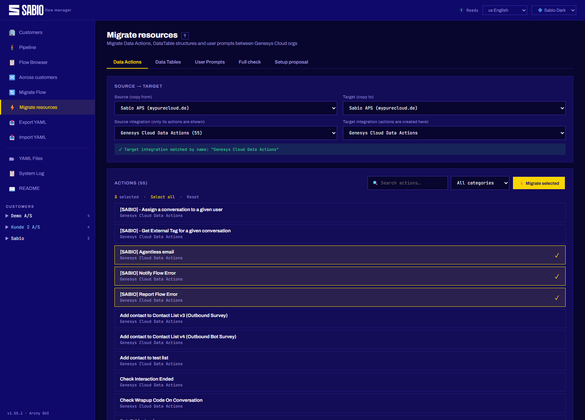

> **The category follows the target integration.** A migrated action is created with the target integration's name as its category — that is what a flow looks it up by — and not with the source's category. If the name cannot be read, the source's is kept. The log says so when the category changes.
>
> **Note:** Category names must match between orgs. If the source uses `Genesys Cloud Data Actions - QM` but the target only has `Genesys Cloud Data Actions`, either rename the integration in the target org or adjust the category in your YAML before importing.

#### 🧙 Flow Builder · Beta
> **Beta.** Flow Builder is still in development. Always check the YAML with **🔍 Validate YAML** and **🌐 Check against org** before importing.

Step-by-step wizard to build Archy YAML without writing it by hand. Supports all 16 flow types, Data Tables, Data Actions with schema fetching, and transfer/disconnect handling.

#### 🗂 YAML Files
Every flow the tool has exported to disk. They arrive from **Export YAML**, but also from **migrations** and **⇄ comparisons**, both of which export along the way.

Archy names the files `<FlowName>_v<major>-<minor>.yaml` — so `Test33_v1-0.yaml` is the flow *Test33* at version *1.0*. The list splits that apart and shows flow name, version, flow type, customer, timestamp and size.

Filter by **customer**, **flow type** and free text. **Latest version only** is on by default, folding away older exports of the same flow — the counter shows how many are hidden.

Each file can be opened (**View**) or sent on to the Import page (**Import**).

**🧹 Clean up** removes old versions: choose how many to keep per flow — 2 by default, so you can fall back to an earlier version — and approve the list before anything is deleted. Files without a version number are left alone.

#### 📋 System Log
All actions logged in real time. Filter by time span, level, action type, customer, and free text. Times are shown in the machine's own time zone (UTC in the tooltip); *15 min* and *1 hour* run up to now, and *Today* starts at midnight.

**SECURITY** shows prod logins, who did or did not get deploy rights and why, and every rejected attempt to write to prod.

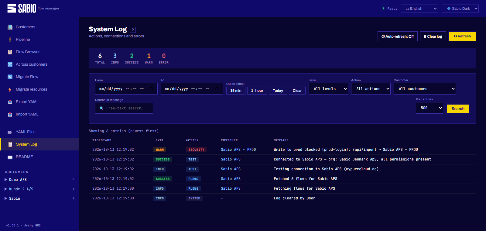

**The log text itself is always English**, whatever language the interface is set to. Column headers and filters follow the language; the lines do not. The log gets pasted into a ticket and read by people who do not necessarily run the app in the same language as whoever ran the migration.

---

### Themes and languages

Both are chosen in the top bar and stored in the browser's `localStorage`, so your choice is remembered.

| Theme | Description |
|---|---|
| 🌙 Archy Dark | Default — dark with orange accent |
| ☀️ Archy Light | Light with orange accent |
| 🔷 Sabio Dark | Sabio brand: navy `#0F096B` with yellow `#F7D501` |
| 🔹 Sabio Light | Sabio brand: off-white with purple `#6518BB` |

The Sabio themes show the Sabio wordmark in the top bar instead of "ArchyGUI" and use the brand's square corners.

Languages: 🇩🇰 Dansk · 🇬🇧 English · 🇫🇷 Français · 🇳🇱 Nederlands · 🇪🇸 Español. Buttons have tooltips in all five languages, and every page has a **?** help.
Technical identifiers are not translated — flow types (`InboundCall`, `Workflow` …), region names, log levels (`INFO`, `ERROR` …) and Genesys category names appear exactly as the API returns them.

---

### Regions

| Org | Region value |
|-----|--------------|
| EU Frankfurt | `mypurecloud.de` |
| US East | `mypurecloud.com` |
| EU Ireland | `mypurecloud.ie` |
| AP Sydney | `mypurecloud.com.au` |
| AP Tokyo | `mypurecloud.jp` |
| US West | `usw2.pure.cloud` |
| EU London | `euw2.pure.cloud` |
| Canada | `cac1.pure.cloud` |

### Security
- Client Secrets never shown in the GUI after saving, and redacted in the log file and system log
- OAuth PKCE: no secret stored — token lives only in server memory
- **A login only counts for the environment's own org.** With trusted orgs you pick the org on Genesys' login page, so the tool checks which org the login landed in before storing the token. If it does not match the environment's known org — or belongs to another customer — the token is discarded. Logins always force a fresh sign-in (`prompt=login`) aimed at the environment's org (`target`), so a remembered session in another org is not silently reused. Both the API calls and Archy re-check the org every time the token is used, and a known org id is never overwritten. The same OAuth client means the same org only for client credentials
- **Writing to prod requires a personal login.** A prod environment must use OAuth (PKCE); with client credentials it can be read but not written to. At login the tool looks the user up in Genesys and checks the permission — `architect:flow:publish` by default — and optionally membership of a group. Both are set per environment under **⚙ Settings**. Deploy rights last 30 minutes after login; then you log in again. **If you restart the program within those 30 minutes, the login is remembered** — so you do not go through MFA again: the token is kept in your own user folder (`~/.archy-gui/session.json`), only for fresh logins and only for the environments and org the login was for, and the file is cleared as they expire. Set `rememberLoginMinutes` to `0` in `settings.json` to keep nothing. Archy and the API calls run with the user's own token, so Genesys enforces the permissions too and the audit log shows the person. Needs a *Code Authorization* OAuth client in the prod org with redirect URI `http://localhost:3737/auth/callback`. Division-scoped permissions (`architect:flow:publish:<division ids>`) count
- Stage, authentication, Client ID, region and deploy requirements of a prod environment can only be changed with a valid prod login — otherwise one could set the stage to "uat", write, and set it back. The exception is a new **Client ID on its own** on an OAuth environment: the login goes through the client, so a deleted or wrong client could otherwise never be fixed. The org id stays, so the new client's login must land in the same org, and writing still requires a fresh prod login. Editing only accepts the editable fields
- The server binds to `127.0.0.1`. Set `HOST` to expose it deliberately — but there is no access control in front of it
- File paths from the UI are confined to `flows/`, for both reading and writing
- Environment fields are checked on save: the name may not contain `< > : " \ | ? * % ! ^ $ '`, backtick or control characters, be a reserved Windows name, or map to the same export folder as another environment; the prefix may only be `A-Z 0-9 _ -`; the Client ID must be a GUID and the region a known one. `/` is allowed, so "A/S" works
- Names from an org are escaped before rendering: `escapeHtml` in HTML text, `jsAttr` inside an `onclick`. A flow named `` renders as text
- Values on Archy's command line are quoted, and a flow name containing a double quote is rejected: Archy is invoked through `cmd.exe`, where the character cannot be escaped

### File structure
```
Archy-gui/
├── server.js          # Express backend
├── start.bat          # Start the server hidden in the background + open browser
├── stop.bat           # Stop the server
├── customers.json     # Customer data (auto-generated)
├── settings.json      # Custom stage list (created when saved)
├── server.log         # Server output
├── flows/             # Local YAML files per customer
│   └── <customername>/
│       └── *.yaml
├── public/
│   └── index.html     # Frontend SPA
├── test/              # Unit tests (npm test)
│   └── *.test.js
├── docs/              # Screenshots and infographic for the README
└── package.json
```

### Tests (for developers)

You do **not** need to run the tests to use the app. They are for whoever changes the code: run them before committing, and you find out if a change broke something that worked.

```bash
npm test
```

420 unit tests covering the pure functions — promotion naming, environment prefixes, the group guard, YAML rewriting and comparison, error messages from Archy and Genesys, and client-secret redaction. None of them touch a Genesys org, a file or Archy, so they can be run at any time.

A couple of them watch that **the stage order and the version suffix exist in only one place** — they read both `server.js` and `index.html` and fail if the rules get copied out again.

`test/sikkerhed.test.js` guards three holes that were open: reading outside `flows/`, writing outside `flows/`, and command injection through a flow name. They are written against the attacks that actually worked.

`test/log-engelsk.test.js` reads `server.js` and fails if a Danish message has slipped into the system log — including by way of a thrown error.

`test/escape.test.js` reads `index.html` and fails if a name from an org reaches the HTML unescaped — and exercises `escapeHtml` and `jsAttr` with names that would otherwise run code.

`test/prod-rettigheder.test.js` fails if a new route that writes to an org is not behind the prod guard. `test/syntaks.test.js` compiles every script in `index.html`, so a single wrong character cannot stop the whole UI. `test/ui-sprog.test.js` and `test/tooltips.test.js` catch Danish bypassing the translations and tooltips — including the ⓘ on fields — pointing to texts that do not exist. `test/miljoer.test.js` and `test/fejl.test.js` check that a login into the wrong org is refused and that Archy never gets a token from another org. `test/readme.test.js` keeps the version and the test count here in step with `package.json`, the UI and `CHANGELOG.md`.

The tests live in `test/` and need nothing beyond Node itself (`node --test`, Node 18+).
